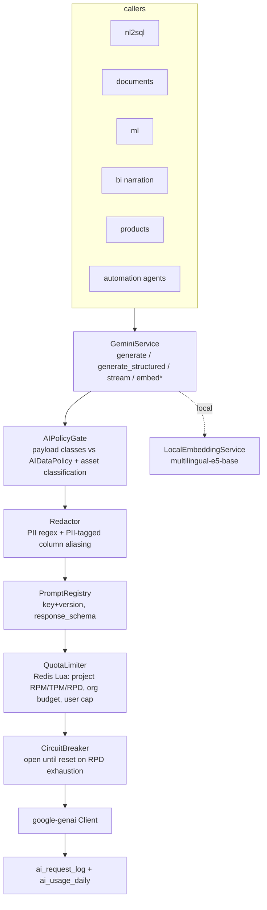

# AI Architecture

> Status: **Design.** Last updated 2026-11-17. Owner agent: AI/ML (`apps/ai`, `apps/nl2sql`, `apps/documents`, `apps/ml`).
> **Hard requirement:** Google Gemini is the **only** external generative-AI provider. No OpenAI, Anthropic, Groq or any other commercial model API. **No fallback provider, ever.** If Gemini is unavailable or out of quota, AI features degrade visibly, and non-AI features keep working.

## 1. Principles
1. **Gemini is scarce.** Every call has to earn its place. Deterministic, local and cached paths come first (§4).
2. **The data policy is enforced in code, not by convention.** Each prompt declares what classes of data it carries, and a gate blocks forbidden payloads before any network call (§5).
3. **Treat model output as untrusted.** Structured output is schema-validated. SQL goes through `sqlguard`. Citations are checked against the source text.
4. **One integration point.** Only `apps/ai/gemini.py` imports `google.genai`; an import-linter rule plus a CI grep enforce this.
5. **Configuration, not code.** Model IDs, tiers and quotas come from env vars and the database. Startup validates them.

## 2. Verified Gemini facts (verified 2026-11-17)

Sources: Google AI developer docs (now served from `aistudio.google.com/docs/*`): models, rate-limits, pricing, terms (effective 2026-03-23), deprecations, libraries.
**Re-verify before each phase that uses AI and before any deployment.** Free-tier quotas change without notice.

### 2.1 SDK
- Python: **`google-genai`** (`pip install google-genai`), GA since May 2025.
- The legacy **`google-generativeai`** package is deprecated (since 2025-11-30) and **must not be used**.
- The same SDK supports **Vertex AI** (`genai.Client(vertexai=True, project=…, location=…)`). That is the production option for enterprise data terms and is still Gemini.

### 2.2 Models relevant to Nexora
| Purpose | Model ID | Status (docs) | Free tier | Notes |
|---|---|---|---|---|
| FAST tier (routing, classification, simple NL→SQL) | `gemini-3.5-flash-lite` | Stable | Yes | **Default** `GEMINI_MODEL_FAST` |
| REASONING tier (multi-table NL→SQL, repair, extraction) | `gemini-3.8-flash` | Stable | Yes | **Default** `GEMINI_MODEL_REASONING`. Reported free RPD is very low (≈20/day). |
| Alternative | `gemini-3.6-flash` | Stable | Yes | Fallback *within Gemini* via configuration |
| Alternative | `gemini-3.1-flash-lite` | Stable | Yes | Shutdown 2027-05-07; avoid for new work |
| Larger model | `gemini-4-hydrogen` | Listed free | Yes | Evaluate in Phase 1 (quality vs quota) |
| Paid only | `gemini-4-carbon`, `gemini-4-argon` | — | **No** | Not used initially |
| VISION tier (scanned docs, optional) | Same Flash family (multimodal input) | — | Yes | Only when local OCR confidence is low and the policy allows `DOCUMENT_TEXT` |
| Embeddings (optional, **not default**) | `gemini-embedding-2` | Current | Listed free | `gemini-embedding-001` shuts down 2028-05-14 |
| **Do not use** | `gemini-2.5-pro`, `gemini-2.5-flash` | Deprecated | — | Shutdown **2026-12-01** |
| **Do not use** | `gemini-2.0-*`, `gemini-3-pro-preview`, `gemini-3.1-flash-lite-preview` | Shut down | — | |

### 2.3 Quotas and limits
- Per-model free-tier RPM, TPM and RPD are **only shown in AI Studio** (the docs page no longer lists them). Community reports put them at about 20 RPD for Flash and a few hundred RPD for Flash-Lite, after cuts in December 2025 and later.
- **Limits apply per Google Cloud project, not per API key.** Every Nexora org shares the platform project's quota.
- RPD resets at **midnight Pacific time**.
- Exhaustion returns **HTTP 429 `RESOURCE_EXHAUSTED`**, sometimes with a `RetryInfo.retryDelay`.
- **The Batch API is not available on the free tier.** Context caching is free only on some models.
- **Spreading load across multiple projects or keys to get around limits is prohibited** by the terms. Nexora will not do it.

### 2.4 Data use and terms
- **Unpaid services (free tier):**
  - Google may use submitted content and responses to improve its products and models.
  - **Human reviewers may read** inputs and outputs. They are disconnected from the account and key first.
  - The terms say: "Do not submit sensitive, confidential, or personal information."
- **Paid services:** prompts and responses are not used to improve products. They are logged for a limited time for abuse detection only.
- **EEA, Switzerland and UK:** only paid services may be used when making API clients available to users there.
- Use is for professional or business purposes; users must be 18+.
- ⇒ This is why **`AIDataPolicy` defaults to `synthetic_only`** and why **the free tier only permits `synthetic_only` or `schema_only`** (§5).

### 2.5 Still to verify in Phase 1 (live, with a dev key and synthetic prompts)
`scripts/verify_gemini.py` checks the following and writes the results to `docs/FEATURE_STATUS.md`:
- that `models.list` contains the configured IDs and none are deprecated;
- structured output with `response_schema` on each configured model;
- function calling;
- streaming;
- `usage_metadata` token counts;
- the 429 shape and `retryDelay`;
- the actual RPM/TPM/RPD for the project, read manually from AI Studio and entered into `ai_model_quota`.

## 3. `apps/ai` components



### 3.1 Configuration (env)
```
GEMINI_API_KEY=                 # required for AI features; never committed
GEMINI_TIER=free                # free | paid | vertex
GEMINI_MODEL_FAST=gemini-3.5-flash-lite
GEMINI_MODEL_REASONING=gemini-3.8-flash
GEMINI_MODEL_VISION=gemini-3.5-flash-lite
GEMINI_VERTEX_PROJECT= / GEMINI_VERTEX_LOCATION=      # only when GEMINI_TIER=vertex
GEMINI_REQUEST_TIMEOUT_S=60
GEMINI_MAX_OUTPUT_TOKENS=2048
EMBEDDING_PROVIDER=local        # local | gemini (optional future)
EMBEDDING_MODEL=intfloat/multilingual-e5-base
EMBEDDING_DIM=768
AI_CONSENT_TEXT_VERSION=2026-11-v1
DEV_AGENT_RPD=40                # cap for cassette recording during development
```
On startup, `ai.checks.validate_models` (a Django system check) confirms that every configured model is present in `models.list` and not on the deprecation list. In dev it warns; in prod it errors.

### 3.2 `GeminiService` behaviour
| Concern | Behaviour |
|---|---|
| Structured output | `response_mime_type=application/json` + `response_schema` (from a pydantic model). Validated with pydantic. On failure: **one** repair call with the validation errors (only if budget remains), then `ai_invalid_output`. |
| Streaming | `generate_content_stream` → async iterator → SSE `token` events. Usage is recorded from the final chunk. |
| Temperature | 0 for SQL and extraction, 0.3 for narration |
| Retries | 429 per-minute and 503 errors: exponential backoff with jitter (1 s, 2 s, 4 s, capped by `retryDelay`), max 3 attempts, as Celery `countdown` retries on the `llm` queue (never a busy-wait). **429 per-day: no retry**, the breaker opens. |
| Timeouts | 60 s request timeout. Overall task soft limit 120 s. |
| Token accounting | `usage_metadata` (prompt, candidates, cached) → `ai_request_log`, `ai_usage_daily`, `usage_daily` |
| Context management | Token-budgeted builders: schema card ≤ 1.5k tokens, conversation memory ≤ 800 tokens (local rolling summary), RAG context ≤ 6k tokens. `client.models.count_tokens` is never called just for budgeting (it costs a request); estimates use a local tokenizer heuristic (chars/3.5) with a safety margin. |
| Safety | Gemini safety blocks map to `ai_invalid_output` with `reason=safety` and are shown to the user. |
| Logging | Metadata always. Redacted prompt text only if `ai_org_config.log_prompt_text`, kept 30 days. The API key is never logged. |

### 3.3 Prompt registry
- Templates are code-first (`apps/ai/prompts/<key>.py`). Each has a `key`, a `version`, a Jinja template, a `response_schema`, its **declared `payload_classes`** and a `model_tier`. Migrations seed them into `ai_prompt_template`.
- A platform admin can activate a newer version. Each request log records `(prompt_key, prompt_version)`.
- **Initial prompts:**

| Key | Payload classes | Tier |
|---|---|---|
| `nl2sql.generate` | SCHEMA | fast or reasoning |
| `nl2sql.repair` | SCHEMA | reasoning |
| `bi.narrate` | SCHEMA, VALUES | fast |
| `semantic.describe_columns` | SCHEMA | fast |
| `quality.suggest_rules` | SCHEMA | fast |
| `docs.answer` | DOCUMENT_TEXT | reasoning |
| `docs.extract` | DOCUMENT_TEXT | reasoning |
| `docs.classify` | DOCUMENT_TEXT | fast |
| `docs.summarize` | DOCUMENT_TEXT | fast |
| `ml.explain_eda` | SCHEMA, VALUES (aggregates) | fast |
| `ml.explain_model` | SCHEMA, VALUES (aggregates) | fast |
| `products.normalize` | VALUES | fast |
| `products.extract_attributes` | VALUES, DOCUMENT_TEXT | reasoning |
| `agent.step` | per tool | reasoning |

- **Prompt-injection hygiene:**
  - Data and document content is wrapped in clearly delimited blocks.
  - The system instruction tells the model to treat block content as data.
  - Outputs never trigger actions without validation (SQL → guard; agent tool calls → allowlist plus approval).

### 3.4 Quota limiter and circuit breaker
- **Redis Lua script.** It atomically reserves one request and an estimated token count, then reconciles the actual tokens after the call. It checks:
  1. **project** RPM/TPM/RPD for the model, from `ai_model_quota`, with a 10% safety margin;
  2. the **org** daily request and token budget (`ai_org_config`, default 50 requests/day);
  3. the **per-user** daily cap (default 20).
- **Priority classes:**
  - **interactive** (chat): can use 100% of the remaining budget;
  - **assistive** (narration, descriptions): up to 60%;
  - **background** (bulk extraction, enrichment): up to 30%.
  - The project budget is never fully consumed by background work.
- **Circuit breaker states:**
  - `closed`: normal.
  - `open_minute`: 429 per-minute; reopens after `retryDelay`.
  - `open_day`: 429 per-day or RPD reached; reopens at the next midnight Pacific.
  - The state is exposed at `GET /orgs/{org}/ai/status` and `GET /platform/ai/usage`.
- **Degraded mode UX:**
  - a banner reading "AI quota reached — resets at 13:30 IST";
  - chat still answers from cache and the deterministic builder;
  - the manual and visual query builder, dashboards and saved queries keep working;
  - document search stays local and extractive.

## 4. Minimizing Gemini calls
| Technique | Where | Expected effect |
|---|---|---|
| Exact question cache (org + dataset version + normalized question) | nl2sql | Repeats cost 0 calls |
| Semantic cache (local embeddings, cosine ≥ 0.93, slot re-binding for dates and numbers via `dateparser` and regex) | nl2sql | Paraphrases cost 0 calls |
| Deterministic builder (semantic-layer metrics × dimensions × time filters; rapidfuzz synonym matching) | nl2sql | "Revenue by region last month" costs 0 calls |
| One call returns SQL + explanation + chart hint | nl2sql | 1 call per novel question (+ ≤ 1 repair) |
| Local insights (Polars: top-N, period-over-period, z-score anomalies, linear trend) + templated narration | bi | Narration costs 0 calls by default |
| Local profiling, quality rules, dedup, EDA statistics, OCR, embeddings, ML training | all | 0 calls |
| Model tiering (FAST by default; REASONING only for multi-table or repair) | ai | Preserves the scarce Flash RPD |
| Batched prompts (e.g. describe 30 columns in one call) | semantic, products | Fewer, larger calls |
| Verified answers promoted to the cache | bi feedback | Accuracy and cache hit rate improve over time |

## 5. AI data policy (`AIDataPolicy`)

### 5.1 Values
- One enum is used everywhere: DB column `organization.ai_data_policy`, the API, the UI and the gate.
- **The default is `synthetic_only` everywhere.**
- **Classified asset** = an asset whose classification is `synthetic` or `public` (admin-attested and audited). **Real asset** = an asset classified `internal` or `confidential` (the default classification).

| Value | Free tier | Consent required | Classified assets | Real assets: SCHEMA | Real assets: VALUES / DOCUMENT_TEXT |
|---|---|---|---|---|---|
| `synthetic_only` **(default)** | ✅ | No | Everything allowed (schema, results, samples, document chunks) | ❌ **No Gemini calls at all** | ❌ |
| `schema_only` | ✅ | **Yes**: org Owner/Admin, re-authenticated | Everything allowed | ✅ Names, types, descriptions and metrics; PII-tagged columns aliased; admin-excluded columns omitted | ❌ |
| `aggregates_only` | ❌ refused | Yes | Everything allowed | ✅ | Aggregates only (k ≥ 5 group size, PII columns excluded) |
| `full` | ❌ refused | Yes, plus a paid tier or Vertex | Everything allowed | ✅ | Redacted samples and document chunks |

### 5.2 Why `schema_only` needs consent
- Table and column names, descriptions and metric definitions can themselves be confidential (for example `acquisition_target_valuation`).
- The consent dialog shows exactly what will be sent and to whom (Google Gemini, free or paid tier), the free-tier data-use and human-review terms, and how to revoke.
- Consent is recorded in `ai_policy_consent` and `audit_event`. A change in `AI_CONSENT_TEXT_VERSION` invalidates the consent, and the org reverts to `synthetic_only` until it re-consents.

### 5.3 Enforcement points
1. **On create:**
   - the DB default is `'synthetic_only'`;
   - the model default is the same;
   - the org-creation service sets it explicitly;
   - serializers make the field read-only;
   - a CI test covers every creation path (sign-up, super-admin create, fixtures).
2. **Policy change API:** refuses values the tier does not allow (`ai_policy_tier_forbidden`) and refuses changes without a valid consent (`ai_policy_consent_required`).
3. **`AIPolicyGate.check(org, PayloadManifest)`:**
   - Runs inside `GeminiService` before every request.
   - Every prompt builder produces a `PayloadManifest` that lists, per payload class, the asset IDs involved.
   - The gate loads the org policy, the consent validity and each asset's classification, then allows or raises `AIPolicyBlocked`.
   - Blocked attempts are logged with `status=blocked_by_policy` and **no network call**.
4. **Redactor:** a final pass that masks emails, phone numbers, Indian PAN/Aadhaar-like patterns, card-like numbers, and aliases PII-tagged column names. It is defence in depth, not the main control.
5. **Server-side tier check:** with `GEMINI_TIER=free`, the gate also refuses any `aggregates_only` or `full` state found in the DB, for example one set by a manual DB edit.

### 5.4 Feature availability matrix (free tier)
| Feature | `synthetic_only` (default) | `schema_only` (consented) |
|---|---|---|
| NL→SQL on classified datasets | ✅ | ✅ |
| NL→SQL on real datasets | ❌ (manual or visual builder only) | ✅ (schema card only) |
| Gemini narration of results | Classified only | Classified only (real: local templates) |
| Local insights and templates | ✅ | ✅ |
| Document Q&A (generative) | Classified documents only | Classified documents only |
| Document search, extractive answers, OCR, extraction (rule-based) | ✅ (local) | ✅ (local) |
| AI column descriptions and rule suggestions | Classified only | ✅ (SCHEMA) |
| EDA and model explanations (aggregates) | Classified only | Classified only |

## 6. Conversational BI pipeline (NL→SQL)

1. **Authorize:** `bi.chat` permission + dataset ACL `query`. Load `QueryPolicy = governance.effective_policy(user, dataset)`.
2. **AI permission:** compute what the policy allows for this dataset. Under `synthetic_only` on a real dataset, AI is skipped: the cache and builder are tried and otherwise the user is pointed to the visual builder (`ai_policy_blocked`).
3. **Resolve** (`nl2sql.propose`): exact cache → semantic cache → deterministic builder → Gemini (`nl2sql.generate`).
   - The prompt has a system instruction (dialect, rules, SELECT-only, use only listed tables and columns).
   - It includes the schema card, filtered to the user's allowed columns, with PII columns aliased and excluded columns dropped.
   - It includes the metric definitions, a conversation summary of at most 800 tokens, and the question.
   - Response schema: `{ sql, tables, columns, assumptions[], chart_hint{type,x,y,series}, clarification_needed?: string }`.
4. **Clarify:** if `clarification_needed` is set, ask the user instead of guessing. No SQL is executed.
5. **Guard and execute:** `sqlguard.validate` → `sqlguard.execute` (`SECURITY_ARCHITECTURE.md` §5).
   - On a guard rejection caused by model error (an unknown column, say), make one `nl2sql.repair` call with the reject code.
   - Never retry a security rejection such as a forbidden function or system catalog; return it to the user and audit it.
6. **Results:** `ResultSet` (≤ 1,000 rows, ≤ 5 MB), chart spec (`chart_hint` validated against the result columns, otherwise heuristics) and local insights.
7. **Explain:** templated narration by default. Gemini narration (`bi.narrate`, streamed) only if the policy allows VALUES for this asset.
8. **Record:** `bi_query_audit` (always), `message`, cache entry (pre-policy SQL template; verified flag after thumbs-up), `access_history`.
9. **Follow-ups:** a rolling local summary of prior turns (last N questions + SQL + column lists, no values) is reused as context. "Same but by region" resolves via the builder when possible.

**Evaluation:** a golden set of 40 questions over the synthetic sales dataset (QA-owned, `backend/tests/ai_eval/`).
- Metric: **execution accuracy**, meaning the result set matches the reference (order-insensitive, with tolerance on numerics).
- Target ≥ 80%.
- CI uses recorded responses (cassettes) and spends no quota. A live evaluation runs manually before each release, within `DEV_AGENT_RPD`.

## 7. RAG and document intelligence (Phase 8)

1. **Extraction:**
   - PDF text: pdfplumber; DOCX: python-docx; XLSX/CSV via the Data Engineering parsers; TXT.
   - **OCR:** Tesseract with `eng+hin+guj` for pages with no text layer or low text density, preprocessed with OpenCV (deskew, binarize).
   - Per-page `ocr_confidence`. Low-confidence pages can optionally use the Gemini VISION tier **only** if the policy allows DOCUMENT_TEXT for the document.
2. **Chunking:**
   - Structure-aware (headings, paragraphs, tables kept intact), 350–500 tokens with 15% overlap.
   - Each chunk keeps `page_from`, `page_to` and `section_path` for citations.
3. **Embeddings (local, default):** `intfloat/multilingual-e5-base` (768-d, ~1.1 GB RAM, CPU), using the `"passage: "` and `"query: "` prefixes. It covers English, Hindi and Gujarati.
   - **Phase 8 evaluation:** compare it with `BAAI/bge-m3` (1024-d, ~2.3 GB, stronger multilingual retrieval) on a 60-query en/hi/gu test set using recall@5 and MRR. Switch only if bge-m3 wins by ≥ 5 points recall@5 and fits RAM; switching requires a migration of the vector dimension and a re-embed job.
   - Embeddings run on the `ml` queue with concurrency 1.
4. **Retrieval:** hybrid. pgvector HNSW cosine top-20 plus Postgres full-text (`tsvector`, `simple` config for hi/gu) top-20, fused with reciprocal rank fusion, then top-8. Optional local cross-encoder re-ranking is planned for later.
5. **Context construction:** chunks are ordered by document and page and wrapped in `<source id="S3" doc="…" page="4">…</source>` blocks, within a 6k-token budget.
6. **Generation (`docs.answer`):**
   - The instruction is: answer **only** from the sources, cite them as `[S3]`, and say "Not found in the provided documents" when the answer is not there.
   - Response schema: `{ answer, citations: [{source_id, quote}], confidence: low|medium|high, unanswerable: bool }`.
7. **Citation verification (local):**
   - Every `quote` must fuzzy-match (rapidfuzz partial ratio ≥ 90) the cited chunk's text, otherwise that citation is dropped.
   - Answers with zero valid citations are replaced with "Not found…", plus the retrieved passages.
   - **No fabricated facts reach the user without a verifiable citation.**
8. **When AI is not allowed** (real documents under `synthetic_only` or `schema_only`): an **extractive answer**, showing the top passages with page links and highlighted query terms. No Gemini call.
9. **Structured extraction** (`docs.extract`): schema-driven fields, each with page citations; uncited fields come back null. Results land in `extraction_result.status='needs_review'`. **High-impact uses (for example invoice approval) require human approval** via `approval_request`.
10. **Comparison:** section alignment and a text diff run locally. A Gemini summary of the differences is optional and depends on policy.

## 8. AI agents and automation (Phase 10)
- **Agents are configurations, not free-roaming processes.** `agent_config` defines the model tier, an **allowlist of tools**, per-tool scopes, `max_steps` (default 8) and which impacts require approval.
- **Tools are server-side functions with typed schemas** (Gemini function calling):
  - `query_dataset` (always via `sqlguard`, using the invoking user's policy);
  - `search_documents`;
  - `create_report_export`;
  - `send_email` (template-based, internal domains only by default);
  - `http_request` (allowlisted hosts, SSRF guard);
  - `create_approval_request`.
- **No tool can modify governance, users, credentials or policies.**
- **Risk tiers:**
  - `low` (read): auto-executes.
  - `medium` (internal writes): auto-executes, then notifies.
  - `high` (external sends, bulk changes, anything financial): **always creates an `approval_request`** and waits.
- **Accountability:**
  - Every step is logged (`workflow_step_run`, `ai_request_log`, `audit_event` with `actor_type='agent'`).
  - Agents run under the identity of the workflow owner, and their permissions are the **intersection** of the owner's permissions and the agent's scopes.
  - Agents are bounded by the org's `AIDataPolicy` and cannot raise it.

## 9. ML-assisted explanations (Phase 9)
- Training and metrics are computed locally (`ML_ARCHITECTURE.md`).
- Gemini explains the EDA and model results for business users using **aggregates only** (metrics, feature importances, distributions), and only where the policy allows VALUES for the asset.
- Otherwise, explanations come from templates.

## 10. Failure modes and handling
| Failure | User-visible behaviour | System behaviour |
|---|---|---|
| Project RPD exhausted | Banner; cache, builder and manual paths still work | Breaker `open_day` until midnight Pacific; platform alert |
| Org daily budget exhausted | "Your organization's AI budget for today is used" | `ai_quota_exhausted`; admin can raise the budget within the project limits |
| Gemini 5xx or timeout | "AI temporarily unavailable" + retry | Up to 3 backoff retries on the `llm` queue |
| Invalid JSON or schema | "Couldn't produce a valid query" + edit-SQL option | 1 repair call, then `ai_invalid_output` |
| Guard rejects SQL | SQL shown with the reject reason | Audit `verdict=rejected`; 1 repair only for non-security codes |
| Policy blocks the request | Explains which policy and how an admin can change it | `blocked_by_policy` log; no network call |
| Model deprecated | Admin warning | Startup check; switch the model via env without a code change |

## 11. Acceptance criteria (AI platform, cumulative)
1. A grep in CI finds `google.genai` imported only in `apps/ai/gemini.py`, and no other LLM SDK is in the dependency lockfile.
2. For a new org (default `synthetic_only`), a question on a real dataset makes **zero** network calls to Gemini. This is proven by an HTTP transport spy in tests.
3. After consent to `schema_only`, the captured prompts contain only SCHEMA (no data values), and PII columns are aliased.
4. Revoking consent blocks the next request immediately.
5. Simulated 429 per-minute → retried. Simulated 429 per-day → breaker open, no further calls, correct `resets_at`.
6. Golden NL→SQL set ≥ 80% execution accuracy using recorded responses.
7. RAG: in the adversarial evaluation (questions whose answers are absent from the documents), at least 95% are answered "Not found", and 100% of displayed citations pass quote verification.
