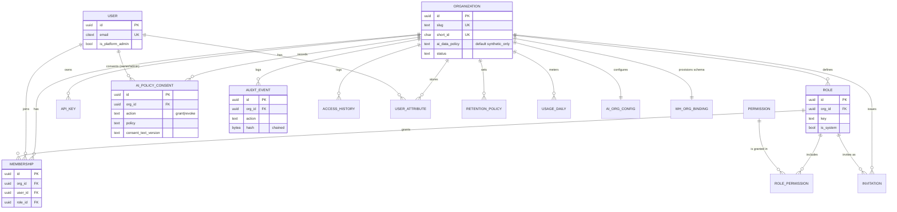
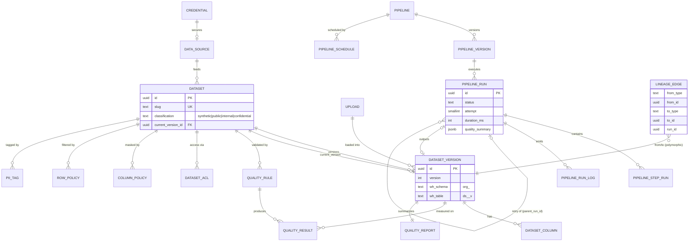
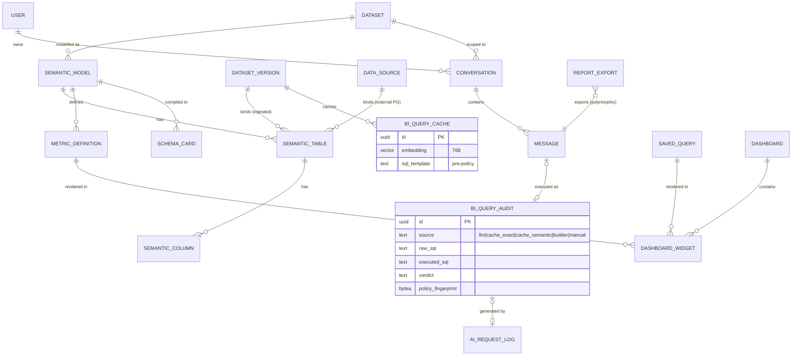
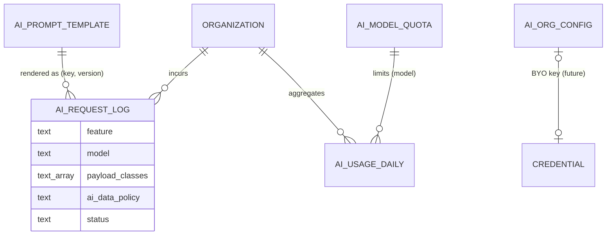
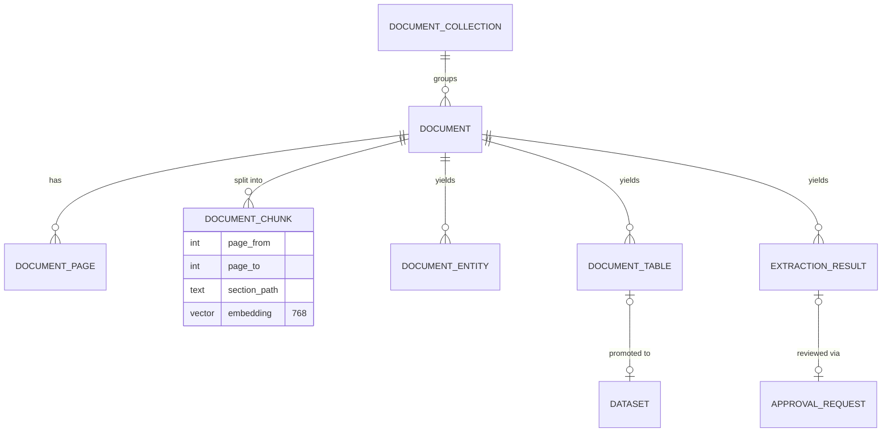
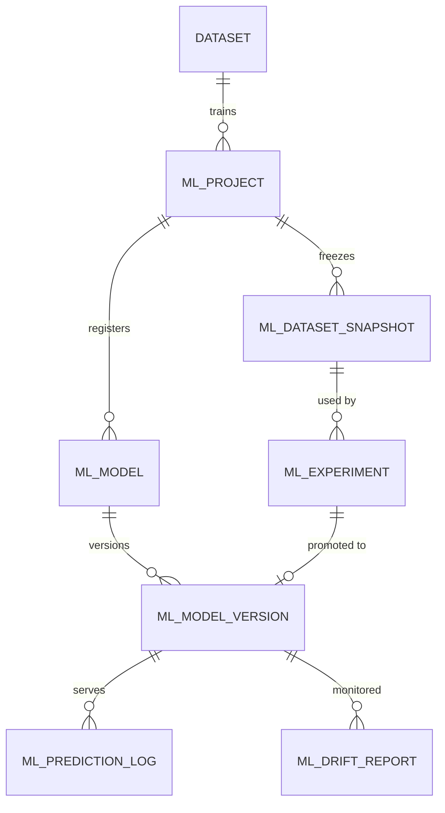
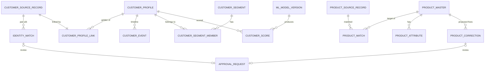
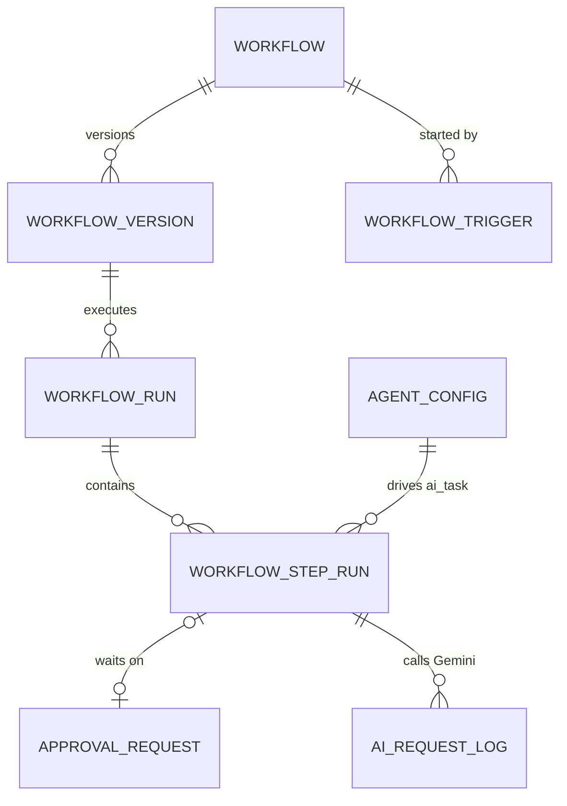
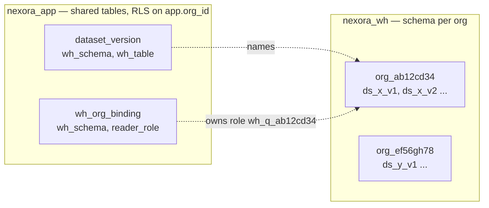

# Database ERD

> Status: **Design.** Last updated 2026-11-17. Column-level detail is in `DATABASE_SCHEMA.md`. These diagrams show only keys and relationships.
> Every entity except `ORGANIZATION`, `USER`, `PERMISSION` and the platform tables carries `org_id`, which is protected by RLS on `app.org_id`. For readability the `org_id` edges are drawn only in diagram 1.

## 1. Identity, tenancy and governance (Phases 2 and 5)

## 2. Data Engineering (Phase 3)

## 3. Semantic layer and Conversational BI (Phase 4)

## 4. AI platform

## 5. Document Intelligence (Phase 8)

## 6. ML Workspace (Phase 9)

## 7. Customer 360 (Phase 6) and Product 360 (Phase 7)

## 8. Automation and agents (Phase 10)

## 9. Cross-database view

