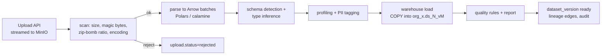
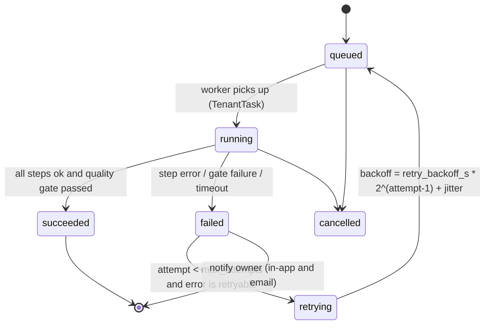

# Data Engineering Design

> Status: **Design.** Last updated 2026-11-17. Phase 3 (MVP). Owner agent: Data Engineering.
> Apps: `connectors`, `datasets`, `pipelines`, `quality`, `lineage`, `warehouse` (and `semantic`/`sqlguard` in Phase 4).

## 1. Goals and MVP scope

**Goals:**
- One place to bring data in, check it, clean it, reshape it and publish it as **versioned, governed datasets** that BI, ML and the other modules can rely on.
- Every pipeline has a source, a destination, transformation steps, an execution status, its duration, error logs, retries and a data-quality summary.

| Capability | MVP (Phase 3) | Later |
|---|---|---|
| CSV, Excel (xlsx/xls), JSON (array or NDJSON) upload | ✔ | Parquet |
| PostgreSQL connector (tables and allowlisted schemas; full and incremental by cursor column) | ✔ | — |
| MySQL connector | Stretch goal | ✔ |
| REST API connector (paginated JSON, API-key or bearer auth) | Stretch goal | ✔ OAuth2 |
| Snowflake, BigQuery, S3, Salesforce | — | Planned (connector SDK) |
| Schema detection, profiling, PII tagging | ✔ | — |
| Validation rules and quality reports | ✔ | Anomaly-based freshness |
| Cleaning and transform steps (§5) | ✔ | Custom Python steps (sandboxed) |
| Exact and fuzzy duplicate detection | ✔ | Probabilistic (Splink), reused by Customer 360 |
| Linear and branching DAG pipelines; visual builder | ✔ (linear plus join) | Arbitrary DAG fan-in and fan-out |
| Schedules (cron plus timezone), retries with backoff, failure alerts (in-app plus email) | ✔ | Webhook alerts |
| Run history, step metrics, logs | ✔ | — |
| Lineage (source → dataset → semantic model → dashboard and model) | ✔ basic | Column-level lineage |

## 2. Connector SDK

```python
class BaseConnector(Protocol):
    type: ClassVar[str]                                # 'csv' | 'excel' | 'json' | 'postgresql' | ...
    config_schema: ClassVar[type[BaseModel]]           # non-secret config (pydantic)
    def test(self) -> TestResult: ...                  # connectivity, privileges, SSRF check
    def introspect(self) -> list[TableSchema]: ...     # within the allowlist only
    def read_batches(self, spec: ReadSpec) -> Iterator[pa.RecordBatch]: ...   # streaming, ≤ 64 MB batches
    def incremental_cursor(self, spec: ReadSpec) -> CursorState | None: ...
```

- **Registration:** connectors register via a registry dict in `connectors/registry.py`. Adding a connector does not touch pipelines.
- **Credentials:** decrypted only inside the worker process at read time (`core.crypto.decrypt(credential_id)`), never logged, never returned by the API.
- **External PostgreSQL rules** (shared with `sqlguard` for Phase 4 queries):
  1. **SSRF guard:** resolve the host once and reject loopback, private (RFC 1918), link-local, CGNAT, multicast and platform-infrastructure ranges, **unless** `ALLOW_PRIVATE_DB_HOSTS=true`, which is a dev-only setting. Store `resolved_ip` and connect with `hostaddr=<pinned ip>` + `host=<name>` (TLS SNI and verification). This blocks DNS rebinding.
  2. `sslmode=verify-full` by default. `require` is allowed with an explicit warning.
  3. **Read-only privilege check** on save and on every `test`:
     - reject `rolsuper`, `rolbypassrls`, `rolcreaterole` and `rolcreatedb`;
     - reject membership in `pg_write_server_files`, `pg_execute_server_program` or `pg_read_server_files`;
     - reject any `INSERT/UPDATE/DELETE/TRUNCATE` privilege on any allowlisted table (`has_table_privilege`).
     - Nexora provides a setup script for a `nexora_ro` role.
  4. **Session settings:** `default_transaction_read_only=on`, `statement_timeout=30s` and `application_name='nexora'` on every session.
  5. Introspection and reads run only on `query_ext` / `ingest` workers. Recommend that the customer points Nexora at a read replica.

## 3. Ingestion flow (file upload)



### 3.1 Upload safety limits
| Check | Default |
|---|---|
| Max file size | 200 MB (configurable per org) |
| Allowed types | `.csv .tsv .txt` (delimited), `.xlsx .xls`, `.json .ndjson`. Magic-byte check. |
| xlsx/docx zip-bomb guard | Uncompressed:compressed ratio > 100, or uncompressed size > 1 GB, rejects the file |
| XML parsing | `defusedxml` everywhere; openpyxl only in `read_only=True` mode |
| CSV dialect | Sniffed delimiter, quote and header; encoding detection (`charset-normalizer`) with a UTF-8 fallback; BOM stripped |
| Excel | Sheet selection (default: first non-empty sheet); merged headers flattened; formulas read as cached values (never evaluated) |
| JSON | Array of objects or NDJSON; nested objects flattened to `parent__child` up to depth 3, deeper levels kept as `jsonb` |
| Row and column caps | 50M rows, 1,000 columns (configurable) |

### 3.2 Schema detection and type inference
- **Sample:** the first 100k rows plus a random 50k reservoir. Polars `infer_schema_length`, then override with Nexora's own rules.
- **Type ladder:** `boolean` → `bigint` → `numeric` / `double precision` → `date` → `timestamptz` → `text`. A type wins only if at least 99.5% of non-null sample values parse. Failing values are counted as `type` quality issues.
- **Semantic types** come from regex and heuristics: email, phone (E.164 and Indian formats), URL, currency (₹ $ € prefixes, Indian grouping such as `1,23,456.00`), percent, country and city (lookup lists), ID-like columns (high cardinality, monotonic), categorical (≤ 5% distinct and ≤ 1,000 values) and free text.
- **Column names** are normalized to `snake_case` ASCII, de-duplicated and truncated to 63 characters. `source_name` keeps the original.
- **Schema drift** between versions (added, removed or retyped columns) is recorded in `dataset_version.profile.drift` and can block a pipeline (`on_drift: fail|warn|evolve`).

### 3.3 Profiling (local, Polars)
- **Per column:** null %, distinct count (HyperLogLog above 1M rows), min, max, mean, stddev, percentiles (p5, p50, p95), top-10 values with counts (**suppressed for PII columns**), length stats for text, and a histogram (20 bins).
- **Dataset level:** row count, duplicate-row count, candidate keys (uniqueness ≥ 99.9%), and correlated numeric pairs (|r| > 0.9).
- **PII tagging:** column-name heuristics + regex hit rate on samples + Presidio (English). This sets `dataset_column.is_pii` and `pii_tag(source=…)`. Hindi and Gujarati PII detection is limited, which is a documented gap, so admins confirm tags manually.

## 4. Warehouse (`nexora_wh`) loading
- `warehouse.provision(org)` runs at org creation:
  - creates schema `org_<short_id>` and role `wh_q_<short_id>` with a random password stored as a `credential`;
  - applies the role defaults (`DATABASE_SCHEMA.md` §5.1);
  - writes `wh_org_binding`.
  - It is idempotent.
- **Loading:**
  - Each dataset version is a new immutable table `ds_<dataset_short>_v<n>`. It is created by `wh_loader` with column types from schema detection and loaded with `COPY FROM STDIN (FORMAT binary)` from Arrow batches.
  - After the load: `ANALYZE` and optional indexes on date and categorical columns used by the semantic layer.
- **Retiring:** old versions are retired by the retention policy (`DROP TABLE` as `wh_loader`). `dataset_version.status='retired'` keeps the metadata.
- **Atomic switch:** `dataset.current_version_id` changes only after a successful load and no blocking quality failures.

## 5. Pipelines

### 5.1 DAG model (`pipeline_version.dag`, validated by JSON Schema)

```json
{
  "nodes": [
    {"key": "src", "type": "source.dataset", "config": {"dataset_id": "…", "version": "current"}},
    {"key": "s1",  "type": "transform.rename", "config": {"map": {"Cust ID": "customer_id"}}},
    {"key": "s2",  "type": "clean.trim_whitespace", "config": {"columns": "*text"}},
    {"key": "s3",  "type": "dedup.exact", "config": {"keys": ["customer_id", "order_id"], "keep": "latest", "order_by": "updated_at"}},
    {"key": "q1",  "type": "quality.gate", "config": {"rule_set": "dataset:<id>", "fail_on": "error"}},
    {"key": "dst", "type": "destination.dataset", "config": {"dataset_id": "…", "mode": "new_version"}}
  ],
  "edges": [["src","s1"],["s1","s2"],["s2","s3"],["s3","q1"],["q1","dst"]],
  "on_drift": "warn",
  "settings": {"max_attempts": 3, "retry_backoff_s": 60, "timeout_s": 3600}
}
```

**Validation:**
- acyclic, exactly one destination in the MVP, and every node reachable from a source;
- each step's output schema is inferred statically, and column references are checked;
- the `join` step allows at most 2 inputs in the MVP.

### 5.2 Step catalog (MVP)
| Category | Steps |
|---|---|
| Source | `source.dataset`, `source.upload`, `source.connector_table` (PG; full or incremental by cursor column) |
| Schema | `transform.rename`, `transform.select`, `transform.cast` (with `on_error: null|reject`), `transform.reorder` |
| Cleaning | `clean.trim_whitespace`, `clean.case` (lower, upper, title), `clean.fill_null` (constant, mean, median, mode, forward-fill), `clean.drop_null_rows`, `clean.standardize_phone`, `clean.standardize_email`, `clean.parse_date` (formats list), `clean.replace_values` (map), `clean.regex_replace` |
| Dedup | `dedup.exact` (keys, keep first or latest), `dedup.fuzzy` (rapidfuzz token-set ratio on chosen columns + blocking key; threshold; output is a cluster ID column or the representative row; **flag mode by default, not deletion**) |
| Reshape | `transform.filter` (structured predicate, not raw SQL), `transform.derive` (safe expression subset, validated by sqlglot expression mode), `transform.aggregate` (group by + aggs), `transform.join` (inner or left, key columns), `transform.union`, `transform.pivot` / `unpivot`, `transform.sort`, `transform.limit` |
| Quality | `quality.gate` (evaluate a rule set; `fail_on: error|warn|never`; rejected rows go to a `_rejected` side output) |
| Destination | `destination.dataset` (`new_version` or `append`, which creates a new version with appended rows; versions are immutable) |

- **Execution engine:** steps compile into a **Polars LazyFrame** plan executed in streaming mode where possible.
- **Memory:** a per-run memory guard (`worker_max_memory_per_child`) keeps runs within bounds; datasets larger than 5M rows are processed in chunks by partition key.
- **No user-supplied code runs in the MVP.**

### 5.3 Execution, retries, failure detection


- **Retryable vs not:** connection or timeout errors and transient warehouse errors are retryable. Validation errors, blocking quality failures and schema-drift failures are not; they fail fast with an actionable `error_code`.
- **Error record:** `pipeline_run.error_code`, `error_message`, `error_detail` (step key, exception class, first failing rows with PII masked), plus `pipeline_run_log` lines.
- **Run metrics:** each run records `rows_in`, `rows_out`, `rows_rejected`, `duration_ms`, per-step timings and the `quality_summary`.
- **Stuck-run detection:** a beat task marks `running` runs older than `timeout_s + 10 min` with no heartbeat as `failed` (`error_code=worker_lost`) and retries them.
- **Concurrency:** one active run per pipeline at a time (Redis lock). Scheduled ticks that arrive while a run is active are skipped and logged.

### 5.4 Scheduling
- `pipeline_schedule` stores cron + timezone + `next_run_at`.
- One beat task, `pipelines.dispatch_due` (every 30 s, using the `nexora_ops` alias), selects due schedules with `FOR UPDATE SKIP LOCKED`, enqueues `run_pipeline(org_id=…, pipeline_id=…)` and advances `next_run_at` with `croniter`. Per-org work then runs under normal tenant context.

## 6. Data quality
- **Rule types:** `not_null`, `unique`, `range`, `regex`, `allowed_values`, `type`, `freshness` (max timestamp age), `row_count` (min, max, or change vs previous version in %), `referential` (values exist in another dataset's column), `expression` (safe boolean expression).
- **Rule suggestions** are local, from the profile:
  - not_null where null % is 0;
  - unique for candidate keys;
  - range from p1/p99 with a margin;
  - allowed_values for low-cardinality columns.
  - An admin reviews and accepts them. AI-suggested rules (`origin='suggested_ai'`) only appear if the AI data policy allows SCHEMA for the asset.
- **Quality score (0–100):** the weighted share of passed rules (error ×3, warn ×1, info ×0), shown across five dimensions: completeness, uniqueness, validity, consistency and freshness.
- **Duplicates section:**
  - exact duplicate rows;
  - key duplicates;
  - fuzzy clusters on configured text columns, using blocking on a normalized prefix to keep comparisons near O(n).
- **Report:** `quality_report` per dataset version. It appears in the UI, can be exported to PDF, and feeds the org dashboard's "data health" panel.

## 7. Lineage
- **Edges are written by the code that causes them** (no inference):

| From | To | Written by |
|---|---|---|
| upload | dataset_version | ingest |
| data_source | dataset_version | connector ingest |
| dataset_version | pipeline_version | run start |
| pipeline_version | dataset_version | run success |
| dataset_version | semantic_model | publish |
| semantic_model / saved_query | dashboard | widget create |
| dataset_version | ml_model_version | training (P9) |
| document | dataset_version | table promotion (P8) |

- **API:** returns up and down graphs to depth N, filtered by the caller's visibility. Nodes the caller cannot see are collapsed into an "N restricted assets" placeholder.
- **UI:** React Flow graph with run-annotated edges ("loaded by run #123, 2 h ago, 1.2M rows").

## 8. Performance targets (dev machine, Docker on Windows)
| Scenario | Target |
|---|---|
| 1M-row, 20-column CSV (≈150 MB): ingest + profile + quality + warehouse load | < 2 min |
| 10M-row CSV | < 15 min, peak worker RSS < 2.5 GB |
| Pipeline of 8 steps on 1M rows | < 90 s |
| Profile-only on a 1M-row dataset | < 30 s |

Measured by `perf/` k6 + pytest-benchmark scenarios (QA-owned). Regressions above 20% fail the nightly build.

## 9. Acceptance criteria (Phase 3)
1. Upload a CSV, XLSX or JSON file → a dataset version is ready with detected types, profile, PII tags and quality report. The rejection paths (oversize, wrong type, zip bomb, malformed file) give the correct error codes.
2. Create a PostgreSQL source → `test` passes for a `nexora_ro` role and **fails** for a role with write privileges (`connector_not_readonly`) or a private host (`connector_host_forbidden`).
3. Build a pipeline (source → rename → clean → dedup → quality gate → destination) in the UI. Publish it, run it, schedule it. The run shows status, duration, row counts, per-step metrics, logs and quality summary.
4. Inject a transient failure → the run retries with backoff and records each attempt. A blocking quality failure fails the run without a retry, and the owner is notified.
5. Lineage shows upload/source → dataset version → pipeline → output version.
6. Every endpoint passes the cross-tenant isolation suite. Org B can never see org A's sources, datasets, runs, logs, lineage or warehouse tables, including through direct SQL as `wh_q_<orgB>`.
7. The performance targets in §8 are met.
