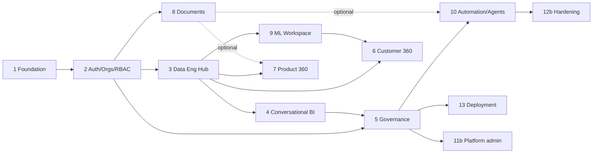

# Implementation Roadmap

> Status: **Design.** Last updated 2026-11-17.
> **Assumptions:** a solo developer with Claude Code parallel agent waves (`AGENT_DEVELOPMENT_STRATEGY.md`), and about 4–6 months available.
> **Estimates** are working weeks. "Sequential" means one stream; "parallel" means agent waves gated by your review.
> **Acceptance criteria** carry IDs (`P<n>-AC<k>`) that map to tagged tests (`TESTING_STRATEGY.md` §8). **A phase is done only when all its AC tests pass on `main`.**

## 0. Summary

| # | Phase | Seq. est. | Depends on | MVP? | Can run in parallel with |
|---|---|---|---|---|---|
| 1 | Architecture, requirements, foundation | 2 wk | — | ✅ | — (serial foundation) |
| 2 | Authentication, organizations, RBAC | 2 wk | 1 | ✅ | Frontend shell, AI service core, pure data engines (§W1) |
| 3 | Data Engineering Hub | 4 wk | 2 (tenancy) | ✅ | Governance models, NL2SQL core, frontend data screens (§W2) |
| 4 | Conversational BI | 3 wk | 3 (+2) | ✅ | Phase 5 |
| 5 | Enterprise data governance | 2 wk | 2–4 | ✅ | Phase 4 integration |
| 11a | Org-admin and BI dashboards (basic) | within 2–5 | | ✅ | |
| 12a | Security testing baseline | within 2–5 | | ✅ | |
| — | **MVP** | **~15 wk seq. / ~12 wk parallel** | | | |
| 8 | Document Intelligence | 3 wk | 1–2 | | 9, 13 |
| 9 | Predictive AI and ML Workspace | 3–4 wk | 3 | | 8, 13 |
| 13 | Deployment and production optimization | 1 wk (+ ongoing) | MVP | | 8, 9 |
| 6 | Customer Intelligence / Customer 360 | 3–4 wk | 3, 9 | | 7 |
| 7 | Product Intelligence / Product 360 | 3 wk | 3, (8) | | 6 |
| 10 | AI Automation and Agents | 4 wk | 2–5, (8) | | — (consumes others' APIs) |
| 11b | Platform super-admin and monitoring (full) | 1–2 wk | MVP | | any |
| 12b | Security hardening (full) | 1–2 wk | all built phases | | — |

- **Recommended order after the MVP:** 8 → 9 → 13 → 6 → 7 → 10 → 11b → 12b. Customer 360's churn and CLV reuse Phase 9's training and registry service, so P9 comes before P6.
- **Six-month outlook:**
  - MVP (Working) + P8 + P9 + P13.
  - P8 and P9 can reach **Working** if their ACs pass; otherwise they are **Prototype**.
  - P6 and P7 can reach **Prototype** at most; P10 stays **Planned**.
  - **Full scope: ~40–45 weeks sequential.**

## 1. Wave plan (parallel execution of the MVP)

Details are in `AGENT_DEVELOPMENT_STRATEGY.md` §6. Summary:

| Wave | Weeks | Content |
|---|---|---|
| W0 | 1–2 | Integrator: docs (✅ this step) → **review pause** → `git init`, scaffold, pre-wiring, CI, ownership check, contracts v1, execution-mode dry run |
| W1 | 3–4 | Phase 2, plus foundations for 3 and 4 in parallel (tenancy checkpoint at the end of week 3) |
| W2 | 5–8 | Phase 3, plus Phase 4 preparation and Phase 5 models |
| W3 | 9–11 | Phase 4 integration + Phase 5 |
| W4 | 12 | Hardening, AC coverage, release candidate |

**Critical path** (cannot be compressed by adding agents): scaffold → tenancy primitives → datasets and warehouse → guard, executor and policy → BI end-to-end → hardening ≈ 11 weeks. **Target 12 weeks, commit to 15.** The buffer is for hardening, not new scope.

---

## Phase 1: Architecture, requirements and project foundation

**Technical objectives**
- Approved design documents.
- A runnable skeleton: Compose stack, Django and Next.js apps, CI, contracts, ownership tooling, and the Gemini service stub verified live with synthetic prompts.

**Requirements**
- The 14 docs + the agent strategy, `OWNERSHIP.md`, `FEATURE_STATUS.md`, and the index.
- `git init`; `.gitignore`, `.editorconfig`, pre-commit (ruff, gitleaks, prettier).
- Monorepo layout (`SYSTEM_ARCHITECTURE.md` §8).
- **Backend skeleton:**
  - settings split into base, dev, test and prod;
  - **all planned Django apps created empty and registered**;
  - root URLs including each app's `urls.py`;
  - Celery app with all queues and routes declared;
  - `/healthz` and `/readyz`.
- **Infra:** `infra/postgres/init/*.sql` (roles, extensions `vector` and `citext`, security-definer function stubs, PUBLIC revokes), Compose (dev), Caddy config.
- **Frontend skeleton:** Next.js App Router, Tailwind, design tokens, the `AppShell` placeholder, OpenAPI client generation script.
- `contracts/openapi.yaml` v1 (Phase 2 endpoints), `contracts/events/*.schema.json`, `contracts/python/*.py` Protocols.
- **CI:** lint, types, import-linter (layers), `scripts/check_ownership.py`, `scripts/check_tenant_guc.sh`, contract diff, test job with service containers.
- `scripts/verify_gemini.py`: live checks (`AI_ARCHITECTURE.md` §2.5) using **synthetic prompts only**, with results recorded in `FEATURE_STATUS.md`.
- **Execution-mode check:** a one-agent worktree Workflow dry run (Mode A), or one test Desktop session (Mode B).

**Dependencies:** none.

**Database migrations:** none beyond Django defaults. The init SQL creates roles and extensions only.

**API endpoints:** `GET /healthz`, `GET /readyz`.

**Frontend components:** tokens, theme provider, `AppShell` stub, `Button`, `Input`, `Card` primitives.

**Backend services:** settings, Celery app, `apps.ai.gemini` stub with the configuration check, `core.tenancy.constants`.

**Testing requirements:** CI green on the empty skeleton. A sample test for each test layer proves the harness works, including that tests run as the `nexora_app` role.

**Acceptance criteria**
- `P1-AC1`: `docker compose up` brings every service up healthy on the Windows dev box. `/readyz` reports DB, Redis and MinIO OK.
- `P1-AC2`: CI runs lint, types, import-linter, ownership check, tenant-GUC grep, contract diff and tests, and blocks merges on failure.
- `P1-AC3`: `verify_gemini.py` confirms the configured model IDs exist and records results for structured output, streaming and 429 handling. The project quota values from AI Studio are entered into the seed for `ai_model_quota`.
- `P1-AC4`: The execution-mode dry run succeeds: a worktree agent's change lands on a branch the Integrator can merge.

**Risks:** Docker Desktop resource limits on Windows; the space in the project path; Gemini model or quota changes. The mitigations are in `SYSTEM_ARCHITECTURE.md` §7 and `AI_ARCHITECTURE.md` §2.

---

## Phase 2: Authentication, organization management and RBAC

**Technical objectives**
- Secure multi-org identity, with tenant isolation enforced at both the application and the database layer from day one.

**Requirements**
- **Tenancy primitives:** `TENANT_GUC`, `tenant_context`, `TenantModel`/`TenantManager` (fail-closed), `TenantAPIView`, `TenantTask`, `EnableTenantRLS`/append-only/partition migration operations, middleware clearing.
- **Accounts:** sign-up (creates the org with **`ai_data_policy='synthetic_only'`**), login/logout, password reset, TOTP MFA, re-authentication.
- **Orgs:**
  - org CRUD and settings;
  - 7 seeded system roles + custom roles;
  - permission catalog;
  - memberships;
  - invitations with email (Mailpit);
  - last-owner protection.
- **AI policy endpoints:**
  - read the policy;
  - consent to `schema_only` (owner/admin + re-auth + versioned consent text);
  - revoke.
- **API keys:** create, list, revoke, scoped.
- **Audit:** `core.audit.record`, `audit_event` (partitioned, append-only), sealing job, verify endpoint.
- **Jobs and SSE infrastructure:** `job` table, `core.jobs.publish`, SSE view with Redis Streams.
- **Security-definer functions:** `nexora_user_orgs`, `nexora_membership_check`, `nexora_invitation_by_token`, `nexora_api_key_lookup`.

**Dependencies:** Phase 1.

**Database migrations**
- `orgs`: `organization`, `role`, `permission`, `role_permission`, `membership`, `invitation`, `ai_policy_consent`.
- `accounts`: `user`, django-otp tables, `api_key`.
- `core`: `audit_event` + partitions, `platform_audit_event`, `job`.
- `ai`: `ai_org_config` (defaults).
- RLS on all of them.

**API endpoints:** the Phase 2 table in `API_SPECIFICATION.md` §5.

**Frontend components:**
- Pages: sign-up, login, MFA, password reset, accept invite.
- `OrgSwitcher`; settings pages (org, members, invitations, roles, API keys); **AI data policy page** with `ConsentDialog` and `ReauthDialog`.
- Audit log viewer; `AppShell` with permission-aware navigation.

**Backend services:** `accounts.services` (auth, MFA), `orgs.services` (create_org, invite, accept, change_role, consent/revoke), `core.audit`, `core.jobs`, `core.permissions` (DRF permission classes keyed by codename).

**Testing requirements**
- Unit and API tests for every endpoint.
- **Tenant isolation suite framework** (QA), live from this phase.
- Raw-SQL RLS tests; AI-policy default and consent tests; lockout and rate-limit tests; secrets-in-logs canary test.

**Acceptance criteria**
- `P2-AC1`: Sign-up → owner can invite → the invitee accepts → the role restricts navigation and API access (403/404 per `API_SPECIFICATION.md` §2).
- `P2-AC2`: The **isolation suite passes with 0 failures** across all Phase 2 endpoints and roles. As `nexora_app` with no `app.org_id`, every tenant table returns 0 rows. A cross-org INSERT violates `WITH CHECK`.
- `P2-AC3`: Every org-creation path yields `ai_data_policy='synthetic_only'`. `schema_only` without consent → `ai_policy_consent_required`. Non-admin consent → 403. Revoke takes effect immediately. `aggregates_only`/`full` on the free tier → `ai_policy_tier_forbidden`.
- `P2-AC4`: Audit events are recorded for all mutations. The chain verification passes, and a tampered row is detected.
- `P2-AC5`: MFA, lockout and re-auth flows behave as specified. No secret appears in logs.

**Risks:** RLS and ContextVar mistakes (mitigated by the fail-closed manager, the isolation suite and the concurrency test); over-engineering custom roles (seeds first, custom later in the phase).

---

## Phase 3: Data Engineering Hub

**Technical objectives**
- Reliable ingestion, profiling, quality and pipelines producing immutable, governed dataset versions in the org's warehouse schema.

**Requirements:** see `DATA_ENGINEERING_DESIGN.md`.
- **Sources and ingestion:** CSV, Excel, JSON uploads; PostgreSQL connector (SSRF guard + read-only check).
- **Analysis:** schema detection, profiling, PII tagging, the warehouse loader and per-org provisioning.
- **Quality:** quality rules, suggestions and reports; duplicate detection.
- **Pipelines:**
  - DAG model, step catalog and the visual builder;
  - validation and dry run;
  - scheduling, runs, retries, failure detection, logs, notifications.
- **Other:** lineage, dataset classification + attestation.
- **Stretch:** MySQL and REST connectors.

**Dependencies:** Phase 2 (tenancy, jobs, audit).

**Database migrations**
- `connectors`: `credential`, `data_source`.
- `datasets`: `upload`, `dataset`, `dataset_version`, `dataset_column`.
- `pipelines`: `pipeline`, `pipeline_version`, `pipeline_schedule`, `pipeline_run`, `pipeline_step_run`, `pipeline_run_log` (partitioned).
- `quality`: `quality_rule`, `quality_result`, `quality_report`.
- `lineage`: `lineage_edge`. `warehouse`: `wh_org_binding`.
- `governance`: `pii_tag` (model owned by Backend, written via a service).

**API endpoints:** the Phase 3 table in `API_SPECIFICATION.md` §5.

**Frontend components:** Sources list and wizard, `FileDropzone` + parse preview, dataset explorer (preview, profile, quality, lineage, versions), `PipelineCanvas` + node inspectors, runs table + run detail with SSE logs, `CronInput`, `LineageGraph`, quality report view.

**Backend services**
- `connectors.registry` + CSV, Excel, JSON and PostgreSQL connectors; `connectors.ssrf`; `core.crypto` (envelope encryption).
- `datasets.ingest`, `datasets.profile`, `datasets.pii`.
- `warehouse.provision`, `warehouse.load`.
- `pipelines.compiler` (DAG → Polars plan), `pipelines.runner`, `pipelines.dispatch_due`.
- `quality.engine`, `quality.suggest`, `lineage.record`.

**Testing requirements**
- Upload corpus (formats, encodings, malformed and adversarial files).
- Connector tests against a Postgres test container with read-only and write roles.
- SSRF tests; pipeline compiler unit tests per step; retry and failure-injection tests.
- Isolation suite on all new endpoints, plus warehouse cross-schema tests.
- Performance benchmarks (§8 of the data engineering design).

**Acceptance criteria:** `P3-AC1` … `P3-AC7` = the acceptance list in `DATA_ENGINEERING_DESIGN.md` §9.

**Risks:** memory blow-ups on large files (Polars streaming + chunking + worker memory limits); Excel edge cases (merged headers, dates as serials); PII detection gaps in Hindi and Gujarati (manual confirmation UI); scope creep in the step catalog (MVP list fixed).

---

## Phase 4: Conversational Business Intelligence

**Technical objectives**
- Natural-language questions answered with **guarded**, audited SQL, plus charts, tables, local insights and transparency, within the Gemini free-tier quota and the `AIDataPolicy`.

**Requirements:** see `AI_ARCHITECTURE.md` §4–6 and `SECURITY_ARCHITECTURE.md` §5.
- **Semantic layer:** models, tables, columns, metrics, synonyms, AI exposure flags and aliases; schema cards.
- **`sqlguard`:** validation pipeline, secure-source rewrite, EXPLAIN check, read-only executor (warehouse + external PG), caps and timeouts.
- **`nl2sql`:** exact and semantic caches (local embeddings), deterministic builder, Gemini generate and repair, clarification.
- **`bi`:**
  - conversations and messages; SSE chat orchestration;
  - local insights + template narration; optional Gemini narration (policy-gated);
  - query history, saved queries, dashboards (BI template), exports (CSV, XLSX, PDF);
  - feedback → cache promotion; manual SQL editor; visual query builder;
  - AI status and quota UX.

**Dependencies:** Phase 3 (datasets, warehouse); Phase 2; `governance.effective_policy` (stubbed from W2, completed in Phase 5).

**Database migrations**
- `semantic`: `semantic_model`, `semantic_table`, `semantic_column`, `metric_definition`, `schema_card`.
- `nl2sql`: `bi_query_cache` (HNSW).
- `bi`: `conversation`, `message`, `bi_query_audit` (partitioned, append-only), `saved_query`, `dashboard`, `dashboard_widget`, `report_export`.
- `ai`: `ai_prompt_template` (seeded), `ai_request_log` (partitioned), `ai_usage_daily`, `ai_model_quota`.

**API endpoints:** the Phase 4 table in `API_SPECIFICATION.md` §5, plus SSE §4.2.

**Frontend components:** Ask page (`ChatThread`, `ChatComposer`, streaming stepper, `SqlTransparencyPanel`, `InsightCard`, chart/table toggle, `PolicyNotice`, `QuotaMeter`); visual query builder; SQL editor; query history; semantic model editor; dashboards grid + widgets + BI template; export dialog.

**Backend services:** `sqlguard.validate`, `sqlguard.execute`, `semantic.compile_card`, `nl2sql.propose`, `nl2sql.cache`, `nl2sql.builder`, `ai.GeminiService`, `ai.policy`, `ai.quota`, `bi.chat.orchestrate`, `bi.insights`, `bi.exports`.

**Testing requirements:** **SQL attack corpus (≥ 60) + fuzzing**, golden NL→SQL evaluation (recorded), cache correctness, policy-gate tests (transport spy), quota and breaker tests, SSE resume tests, export injection tests, isolation suite, performance (query p95).

**Acceptance criteria**
- `P4-AC1`: The attack corpus is 100% rejected or neutralized. Nightly fuzzing (10k examples) accepts no forbidden construct.
- `P4-AC2`: Golden set ≥ 80% execution accuracy (recorded responses).
- `P4-AC3`: Every answer shows the executed SQL and source, and writes `bi_query_audit`. Rejections are audited with reject codes.
- `P4-AC4`: Under the default `synthetic_only` policy, questions on real datasets make **zero Gemini calls** and the visual builder works. On classified (synthetic) datasets, AI works end to end.
- `P4-AC5`: A repeated or paraphrased question is served from cache with 0 Gemini calls. In the demo script, ≥ 50% of questions are answered without Gemini.
- `P4-AC6`: A simulated quota exhaustion shows the degraded-mode UI with the correct reset time. The cache, builder and dashboards keep working.
- `P4-AC7`: Exports open correctly, and formula-injection payloads are escaped.
- `P4-AC8`: Cached guarded query p95 < 400 ms; aggregate on 1M rows p95 < 1.5 s.

**Risks:**
- NL→SQL accuracy (mitigated by the semantic layer, clarifications, feedback loop and SQL editing);
- quota scarcity (caches, builder, budgets);
- sqlglot and Postgres disagreements (round-trip + EXPLAIN check);
- SSE through proxies (Caddy flush, heartbeat).

---

## Phase 5: Enterprise data governance

**Technical objectives**
- Fine-grained data access policies enforced in every query path, plus full auditability and usage visibility.

**Requirements**
- **Policies:** dataset ACLs; column policies (deny and masks); row policies with user attributes; `effective_policy` with fingerprint; the policy preview "as user".
- **Data handling:** PII tag review UI, retention policies + jobs.
- **Visibility:**
  - access history;
  - usage metering (`usage_daily`) and AI usage views;
  - AI config (budgets, prompt logging opt-in);
  - audit log UI with chain verification;
  - Org-Admin dashboard (basic).

**Dependencies:** Phases 2–4.

**Database migrations:** `governance`: `dataset_acl`, `column_policy`, `row_policy`, `user_attribute`, `retention_policy`, `usage_daily`, `access_history` (partitioned). `pii_tag` comes from P3.

**API endpoints:** the Phase 5 table in `API_SPECIFICATION.md` §5.

**Frontend components:** policy editors (column grid, row predicate builder), preview-as-user panel, PII review, retention settings, access history, usage charts, AI usage + budgets, Org-Admin dashboard template.

**Backend services:** `governance.effective_policy`, `governance.preview`, `governance.retention.run` (beat-dispatched per org), `governance.usage.record`, `governance.access.record`.

**Testing requirements:** a policy matrix (role × policy × query shape → expected rows and masks), including chat, dashboards, exports, preview and manual SQL; retention job tests; isolation suite; AC tests for consent and defaults (re-run).

**Acceptance criteria**
- `P5-AC1`: Row and column policies change results for restricted users exactly as specified, across chat, manual SQL, dashboards, exports and dataset preview.
- `P5-AC2`: Every query, export and view appears in `access_history` / `bi_query_audit` with the correct actor.
- `P5-AC3`: New orgs default to `synthetic_only` on every creation path. `schema_only` is refused without valid Owner/Admin consent, and revoking reverts immediately.
- `P5-AC4`: With the default policy, no Gemini request carries a real asset's schema or values, proven by assertions on the payload-class gate.
- `P5-AC5`: The retention job deletes or anonymizes per policy, and audit retention minimums are enforced.
- `P5-AC6`: Usage and AI usage numbers reconcile with the logs (±0).

**Risks:** policy semantics confusion (deny-wins, documented and previewable); performance of predicate injection on large tables (indexes on policy columns, suggested automatically).

---

## Phase 6: Customer Intelligence / Customer 360 (post-MVP)

**Technical objectives**
- Unified customer profiles from multiple sources, with explainable identity resolution and predictive scores.

**Requirements**
- **Profiles:**
  - source mapping (datasets → customer fields);
  - normalization (names, emails, phones in E.164, addresses);
  - **identity resolution** with Splink (blocking + probabilistic matching) and match probabilities;
  - thresholds: auto-merge ≥ 0.95, review 0.7–0.95, reject < 0.7 (configurable);
  - **human review queue**;
  - golden records with survivorship rules.
- **Analytics:**
  - activity timeline, purchase history;
  - segmentation (rules, K-Means, hierarchical);
  - behaviour metrics (RFM);
  - churn and CLV via the P9 registry, with confidence + SHAP explanations;
  - rule-based next best action;
  - personalized recommendations (item-item co-occurrence, local).
- Gemini is optional, for segment narratives (policy-gated).

**Dependencies:** Phase 3, Phase 9 (training and registry), Phase 10's approval request table (or a P6-local equivalent if P10 is not done yet; owned by `automation`, so it would be created early on request).

**Database migrations:** `customers` tables (`DATABASE_SCHEMA.md` §10); `approval_request` (if not yet present).

**API endpoints:** the Phase 6 table in `API_SPECIFICATION.md`.

**Frontend components:** source mapping wizard, match review queue (side-by-side records, feature contributions), customer list and profile (timeline, scores, segments), segment builder, Customer dashboard.

**Backend services:** `customers.normalize`, `customers.resolve` (Splink), `customers.golden`, `customers.segments`, `customers.scoring` (calls `ml.services.predict`).

**Testing requirements:** resolution precision and recall on `customers_multi_source` ground truth; review-flow tests; scoring explanation tests; isolation suite.

**Acceptance criteria**
- `P6-AC1`: Pairwise precision ≥ 0.95 and recall ≥ 0.90 on the synthetic multi-source set. Uncertain pairs go to review, and review decisions apply correctly.
- `P6-AC2`: Every profile shows its contributing source records and the match evidence.
- `P6-AC3`: Churn and CLV scores have confidence and top-driver explanations. Retraining goes through the ML registry with approval.
- `P6-AC4`: The isolation suite passes.

**Risks:** Splink tuning effort; data volume (blocking keys); privacy (customer PII is never sent to the Gemini free tier, which the default policy already guarantees).

---

## Phase 7: Product Intelligence / Product 360 (post-MVP)

**Technical objectives**
- Consistent product master data from inconsistent supplier feeds, with every automated correction reviewable.

**Requirements**
- **Ingestion and matching:**
  - product import (P3 connectors) and SKU normalization (rules: case, separators, supplier prefixes);
  - duplicate detection: rapidfuzz on names + attribute overlap + local embedding similarity (pgvector).
- **Attributes:**
  - extraction: regex and units first (dimensions, weight, color, size), with Gemini extraction from descriptions and documents only when the policy allows;
  - missing-attribute detection per category template;
  - classification and categorization (local TF-IDF + LinearSVC baseline trained on the labelled master; Gemini suggestions optional);
  - enrichment proposals.
- **Quality and review:**
  - conflict detection (supplier A vs B values);
  - quality score per product;
  - supplier data validation rules;
  - **every correction goes through `product_correction` (proposed → approved → applied)**;
  - semantic product search.

**Dependencies:** Phase 3; Phase 8 (optional, for document attribute extraction).

**Database migrations:** `products` tables (`DATABASE_SCHEMA.md` §10).

**API endpoints:** the Phase 7 table in `API_SPECIFICATION.md`.

**Frontend components:** product master list and detail (attributes with source and confidence), match review, correction review queue with diff, category template editor, supplier quality dashboard, semantic search.

**Backend services:** `products.normalize`, `products.match`, `products.extract`, `products.classify`, `products.quality`, `products.corrections`.

**Testing requirements:** matching precision and recall on `products_suppliers` ground truth; correction workflow tests (nothing applies without approval); extraction field accuracy; isolation suite.

**Acceptance criteria**
- `P7-AC1`: Duplicate-product detection with F1 ≥ 0.9 on the synthetic set.
- `P7-AC2`: **No automated change is applied without an approved correction record.** Every applied change is audited.
- `P7-AC3`: Rule-based attribute extraction accuracy ≥ 0.9 on the labelled set. AI extraction runs only on classified assets under the default policy.
- `P7-AC4`: Semantic search returns the relevant product in the top 5 for ≥ 85% of test queries.

**Risks:** category taxonomy design; units and locale normalization; AI extraction quota (batch prompts, background priority).

---

## Phase 8: Document Intelligence (post-MVP)

**Technical objectives**
- Reliable extraction, OCR (en/hi/gu), search and cited Q&A over business documents, with no fabrication.

**Requirements:** see `AI_ARCHITECTURE.md` §7.
- **Pipeline:** upload (PDF, DOCX, XLSX, CSV, TXT, scanned images) → text extraction → OCR → classification (local keyword and TF-IDF baseline; Gemini only if the policy allows) → entities (regex + Presidio) → tables.
- **Retrieval:** chunking, local embeddings (multilingual-e5-base; bge-m3 evaluation), hybrid search.
- **Answers and outputs:**
  - RAG Q&A with verified citations;
  - extractive fallback;
  - summarization (extractive locally; Gemini where allowed);
  - comparison;
  - information verification (claim vs source passages);
  - structured extraction with review;
  - document generation (templated DOCX/PDF from data, local).
- Human approval for high-impact extracted decisions.

**Dependencies:** Phases 1–2 (and P3 for table promotion).

**Database migrations:** `documents` tables (`DATABASE_SCHEMA.md` §8).

**API endpoints:** the Phase 8 table in `API_SPECIFICATION.md`.

**Frontend components:** document library, viewer (page images + highlighted citations), Q&A panel with `CitationChip`, extraction review form, compare view, collection settings (classification).

**Backend services:** `documents.extract`, `documents.ocr`, `documents.chunk`, `ai.embeddings.local`, `documents.search`, `documents.answer`, `documents.verify_citations`, `documents.extract_structured`, `documents.generate`.

**Testing requirements:** OCR accuracy on generated scanned en/hi/gu pages (character error rate); retrieval recall@5; RAG faithfulness set; extraction precision; upload security; isolation of vectors.

**Acceptance criteria**
- `P8-AC1`: OCR character error rate ≤ 5% (en) and ≤ 10% (hi/gu) on clean synthetic scans.
- `P8-AC2`: Retrieval recall@5 ≥ 0.85 on the 60-query multilingual set. The embedding model decision (e5-base vs bge-m3) is recorded.
- `P8-AC3`: Unanswerables → "Not found" in ≥ 95% of cases. 100% of displayed citations are verified.
- `P8-AC4`: Under the default policy, real documents get extractive answers with zero Gemini calls.
- `P8-AC5`: Extraction results require review before use, with decisions audited.

**Risks:** OCR quality on poor scans (preprocessing, confidence display); CPU memory for embeddings (concurrency 1, batch size tuning); Gujarati full-text search (the `simple` config + vector search).

---

## Phase 9: Predictive AI and ML Workspace (post-MVP)

**Technical objectives**
- A governed workspace from EDA to monitored predictions, with recommendation-driven model choice.

**Requirements:** see `ML_ARCHITECTURE.md` (dataset management, EDA, preprocessing, missing values and outliers, feature engineering and selection, training, evaluation, comparison, versioning, prediction API, monitoring; regression, classification, clustering, forecasting, anomaly detection, churn templates).

**Dependencies:** Phase 3.

**Database migrations:** `ml` tables (`DATABASE_SCHEMA.md` §9).

**API endpoints:** the Phase 9 table in `API_SPECIFICATION.md`.

**Frontend components:** project wizard (objective, target, metric), EDA report, recommendations panel, experiment launcher, comparison view (metrics table, ROC/PR, confusion matrix, residuals, importance), model registry + promotion, prediction playground, monitoring dashboard (C).

**Backend services:** `ml.eda`, `ml.recommend`, `ml.snapshot`, `ml.train`, `ml.evaluate`, `ml.registry`, `ml.predict`, `ml.monitor`.

**Testing requirements:** metric correctness against sklearn references; reproducibility; recommender rule tests; prediction schema validation; drift detection with injected shift; isolation of artifacts.

**Acceptance criteria:** `P9-AC1` … `P9-AC6` = `ML_ARCHITECTURE.md` §12.

**Risks:** CPU time limits (time budgets, sampling); pickle safety (only self-trained artifacts, hash-checked); library version drift (`lib_versions` pinned per artifact).

---

## Phase 10: AI Automation and Agents (post-MVP)

**Technical objectives**
- Governed automation of repetitive processes, with AI agents limited to allowlisted tools and human approval for high-impact actions.

**Requirements**
- Workflow builder (canvas) and versioning.
- Triggers: manual, schedule, webhook (HMAC), event (pipeline succeeded or failed, dataset quality below threshold, new document).
- Conditional branches, HTTP integration (SSRF guard, allowlisted hosts), email automation (templates), approval workflows, dataset query step (guarded).
- **AI task step:** an agent with a tool allowlist, max steps, the intersection of permissions, and approvals for high impact.
- Execution logs, retries, failure recovery (resume from the failed step).

**Dependencies:** Phases 2–5; Phase 8 for document tools.

**Database migrations:** `automation` tables (`DATABASE_SCHEMA.md` §11).

**API endpoints:** the Phase 10 table in `API_SPECIFICATION.md`.

**Frontend components:** `WorkflowCanvas`, step inspectors, trigger config, run viewer (step timeline, logs), approvals inbox, agent configuration (tools, scopes, approval rules).

**Backend services:** `automation.engine` (state machine on Celery), `automation.triggers`, `automation.steps.*`, `automation.agent` (Gemini function calling + tool registry), `automation.approvals`.

**Testing requirements:** engine state-machine tests; the approval gate cannot be bypassed (property tests); agent tool allowlist enforcement; prompt-injection scenarios (malicious document content trying to call tools); webhook signature tests; isolation suite.

**Acceptance criteria**
- `P10-AC1`: High-impact actions always create approval requests. No execution happens before approval (property-tested).
- `P10-AC2`: Agents can call only allowlisted tools, with the intersection of permissions. Injected instructions in data cannot add tools or scopes.
- `P10-AC3`: Failed steps retry per policy, and runs can resume from the failed step.
- `P10-AC4`: Every agent step is logged in `workflow_step_run`, `ai_request_log` and `audit_event` (`actor_type='agent'`).

**Risks:** agent unpredictability (tight tool schemas, max steps, approvals); quota consumption (background priority class); email deliverability (paid provider needed in production).

---

## Phase 11: Admin dashboards and platform monitoring

**Technical objectives:** complete persona dashboards A–D and platform operations visibility.

**Requirements:**
- **11a (MVP):** Org-Admin and BI dashboards, incrementally in P2–P5.
- **11b:** Platform super-admin:
  - all orgs, org activity, platform health;
  - Gemini project usage vs AI Studio quotas + breaker;
  - infrastructure metrics, background jobs, system logs;
  - suspend and reactivate orgs.
- The ML dashboard comes with P9.

**Dependencies:** MVP; Prometheus/Grafana from P13 for infrastructure metrics.

**Database migrations:** `platform_health_snapshot`; read models over `ai_usage_daily`, `usage_daily` and `job`.

**API endpoints:** the Phase 11 table in `API_SPECIFICATION.md`.

**Frontend components:** dashboards A–D (`UI_UX_SPECIFICATION.md` §6), platform admin area (separate nav, visible only to platform admins).

**Backend services:** `platform_admin.overview`, `.health`, `.jobs`, `.ai_usage`, `.logs` (via the `nexora_ops` alias, aggregates only).

**Testing requirements:** platform endpoints never return tenant data rows (assertion on response schemas); only platform admins can access them; tests for each health indicator.

**Acceptance criteria**
- `P11-AC1`: Super-admin sees per-org counts, health and Gemini usage, and **never** tenant data rows.
- `P11-AC2`: Org Admin sees pipeline health, AI usage vs budget and system activity, with numbers that reconcile with the logs.
- `P11-AC3`: Suspending an org blocks access within 1 minute and is audited in `platform_audit_event`.

**Risks:** the BYPASSRLS ops alias is powerful (confined to platform modules by lint; read-only aggregates).

---

## Phase 12: Security hardening and testing

**Technical objectives:** move from the baseline (12a, continuous since P2) to hardened (12b).

**Requirements:**
- **12a (MVP, continuous):** isolation suite, SQL corpus and fuzzing, AI policy tests, upload security, secrets hygiene, dependency, image and secret scanning.
- **12b:**
  - MFA enforcement for admins; session management UI;
  - CSP hardening; rate-limit tuning;
  - an OWASP ZAP baseline scan against staging;
  - an independent review of `sqlguard`, tenancy, `ai.policy`, `crypto` and SSRF;
  - a threat-model refresh;
  - a pen-test checklist;
  - a KEK rotation drill;
  - a backup restore drill;
  - optional ClamAV scanning for uploads;
  - a load test at 2× expected pilot load.

**Dependencies:** all built phases.

**Database migrations:** none expected (possibly index tuning).

**API endpoints:** session management (`GET/DELETE /me/sessions`).

**Frontend components:** sessions page, security settings.

**Backend services:** none new; hardening of existing ones.

**Testing requirements:** ZAP baseline clean (no high findings); full AC regression; performance at 2× load.

**Acceptance criteria**
- `P12-AC1`: All `SECURITY_ARCHITECTURE.md` §12 gates pass on `main`.
- `P12-AC2`: The ZAP baseline has no High findings, and Mediums are triaged.
- `P12-AC3`: The KEK rotation and restore drills succeed and are documented.

**Risks:** findings late in the schedule (mitigated by doing 12a continuously).

---

## Phase 13: Deployment and production optimization

**Technical objectives:** a secure, observable, recoverable single-VM production deployment.

**Requirements:** `DEPLOYMENT_ARCHITECTURE.md`:
- production images and the Compose production topology with network zones;
- Caddy TLS; secrets handling; the CI/CD release flow with migration job and auto-rollback;
- backups (pgBackRest, MinIO sync); observability (Prometheus, Grafana, Sentry, alerts); runbooks;
- performance tuning (Postgres configuration, indexes, worker concurrency);
- **the Gemini paid-tier or Vertex switch procedure** for real-data pilots.

**Dependencies:** MVP.

**Database migrations:** none (index tuning only).

**API endpoints:** `/metrics` (internal).

**Frontend components:** none (status page optional).

**Backend services:** none new.

**Testing requirements:** staging deployment smoke; rollback test; restore drill; load test.

**Acceptance criteria**
- `P13-AC1`: A fresh VM reaches a healthy production deployment from runbooks in under 2 hours.
- `P13-AC2`: Failed-release auto-rollback works (simulated).
- `P13-AC3`: A backup restore to a new VM succeeds within the RTO.
- `P13-AC4`: Alerts fire for the simulated conditions in `DEPLOYMENT_ARCHITECTURE.md` §7.

**Risks:** single-VM single point of failure (documented; scaling path); cost of the paid Gemini tier when going live with real data.

---

## Appendix A: Independence map

| Safe to build in parallel (after their dependencies) | Why |
|---|---|
| 8 ∥ 9 ∥ 13 | Separate apps, separate owners (AI/ML for 8 and 9 sequentially or in two sessions; Integrator for 13) |
| 6 ∥ 7 | Separate apps (`customers`, `products`); two Data Engineering agent instances |
| Frontend ∥ backend in every phase | Contract-first via `contracts/openapi.yaml` + Prism mock |
| QA suites ∥ implementation | Written against Protocols and contracts (TDD) |

## Appendix B: Feature status at plan approval
All modules are **Planned**. See `FEATURE_STATUS.md`.
