# ML Architecture

> Status: **Design.** Last updated 2026-11-17. Phase 9 (post-MVP). Owner agent: AI/ML (`apps/ml`).
> Conventional ML uses **open-source Python libraries locally**: scikit-learn, XGBoost, SHAP, statsmodels. Gemini is used only for business-facing explanations, within the `AIDataPolicy` (`AI_ARCHITECTURE.md` §9).

## 1. Workspace flow

```mermaid
flowchart LR
  DS[Dataset version] --> PJ[ML project<br/>objective, target, primary metric]
  PJ --> EDA[EDA<br/>local stats + charts]
  EDA --> REC[Model recommendation<br/>rules over data profile + objective]
  REC --> SNAP[Snapshot<br/>frozen parquet + split spec]
  SNAP --> EXP[Experiments<br/>pipelines: preprocess + model + CV]
  EXP --> CMP[Compare<br/>metrics, curves, importance]
  CMP --> REG[Register version<br/>artifact + feature schema]
  REG --> APR[Promote to production<br/>approval request]
  APR --> API[Prediction API<br/>online + batch]
  API --> MON[Monitoring<br/>drift + performance]
  MON -->|alert| PJ
```

## 2. Dataset management and EDA
- **Snapshots:**
  - Datasets come from the Data Engineering Hub (immutable versions).
  - A **snapshot** freezes the training data as Parquet in MinIO (`orgs/{org}/ml/snapshots/{id}.parquet`), together with `feature_schema` and `split_spec` (random/stratified/time-based, test fraction, seed).
- **EDA (local):**
  - Shape, dtypes, missing-value matrix, univariate distributions, target distribution and class balance.
  - Correlations (Pearson and Spearman; Cramér's V for categoricals), outliers (IQR and z-score; IsolationForest summary), leakage hints, duplicate rows, high-cardinality categoricals.
  - For time-indexed data: seasonality and stationarity (ADF test).
  - Charts are rendered client-side from JSON.
- **Missing values:** detection per column, with a recommended strategy (drop column if > 60% missing, median/mode imputation, an indicator flag).
- **Outliers:** detection flags only. Removal is an explicit preprocessing choice that the user makes.

## 3. Preprocessing and feature engineering (sklearn `Pipeline` / `ColumnTransformer`)
| Step | Options |
|---|---|
| Imputation | Simple (mean, median, most_frequent, constant), KNN imputer (≤ 50k rows) |
| Encoding | One-hot (≤ 30 levels), target encoding (cross-fitted), ordinal, frequency |
| Scaling | Standard, robust, min-max (only for scale-sensitive models: linear, KNN, k-means) |
| Dates | Year, month, day of week, is_weekend, days-since features |
| Text (light) | TF-IDF (bounded features) for short text columns |
| Feature selection | Variance threshold, mutual information, L1-based, permutation importance pruning |
| Class imbalance | `class_weight`, threshold tuning; SMOTE (imbalanced-learn) only within CV folds |

**The preprocessing is serialized inside the model artifact**, so prediction-time transforms match training exactly.

## 4. Supported models
| Objective | Models | Library |
|---|---|---|
| Regression | Linear Regression (+Ridge/Lasso), Random Forest Regressor, XGBoost Regressor | sklearn, xgboost |
| Classification | Logistic Regression, Random Forest, XGBoost, KNN | sklearn, xgboost |
| Clustering | K-Means (+ elbow and silhouette for k), Agglomerative (hierarchical) + dendrogram | sklearn, scipy |
| Time-series forecasting | Seasonal naive (baseline), ETS / Holt-Winters, SARIMA (statsmodels), XGBoost with lag features | statsmodels, xgboost |
| Anomaly detection | IsolationForest, robust z-score / MAD, Local Outlier Factor | sklearn |
| Churn prediction | Classification template: churn label definition helper (inactivity window), time-based split, calibrated probabilities | sklearn, xgboost |

**PyTorch is not included.** It would be added only for a justified need (for example sequence models on large event data). No GPU is assumed.

## 5. Model recommendation (no blind selection)
`ml.recommend(profile, objective, business_goal)` returns a ranked list with **reasons**, using rules like these:

| Condition | Recommendation and reason |
|---|---|
| Rows < 1k | Prefer Logistic/Linear Regression and Random Forest (small depth): lower variance. Warn about reliability. |
| Explainability is required (business goal mentions compliance or credit) | Logistic or Linear first, with coefficients; tree models second, with SHAP |
| Mostly tabular, mixed types, nonlinear relationships, > 5k rows | XGBoost and Random Forest first |
| High-dimensional sparse (TF-IDF) | Logistic Regression (L2/L1) |
| Strong class imbalance (minority < 10%) | Use PR-AUC and F1 instead of accuracy; class weights; calibrated XGBoost |
| Features on very different scales + KNN chosen | Require scaling; warn when rows > 100k (prediction cost) |
| Time-indexed target | Time-based split mandatory; forecasting models; never a random split |
| Clustering with unknown k | K-Means with a silhouette sweep for k = 2..10; hierarchical when rows ≤ 10k |
| Target leakage suspected (feature correlation with target ≥ 0.98 or a post-event timestamp) | Block training until the user acknowledges or removes it |

The recommendation is shown before training. The user can override it, and the override is recorded.

## 6. Training and evaluation
- **Execution:** experiments run on the `ml` Celery queue as `TenantTask`.
  - Defaults: 5-fold CV (stratified for classification, `TimeSeriesSplit` for time data) plus a held-out test set.
  - Hyperparameter search: bounded randomized search, max 20 candidates in the MVP, with a time budget per experiment (default 10 min).
  - A fixed `random_seed` is recorded.
- **Metrics:**

| Task | Metrics |
|---|---|
| Classification | Accuracy, Precision, Recall, F1 (macro and weighted), ROC-AUC, PR-AUC, log loss, confusion matrix, calibration curve |
| Regression | MAE, RMSE, R², MAPE (when no zeros), residual plots |
| Clustering | Silhouette, Davies–Bouldin, Calinski–Harabasz, cluster sizes and profiles |
| Forecasting | MAE, RMSE, sMAPE on a rolling-origin backtest |
| Anomaly | Precision@k when labels exist; otherwise anomaly-rate stability |

- **Explainability:** permutation importance for all models; SHAP (TreeExplainer for tree models, LinearExplainer for linear) for global and per-prediction explanations.
- **Comparison:** a side-by-side metrics table, ROC/PR overlays and an importance comparison. The champion is selected by the project's `primary_metric`, with a tie-break on simplicity.

## 7. Registry and versioning
- **Artifact:** joblib-serialized `Pipeline` in MinIO (`orgs/{org}/ml/models/{model}/{version}.joblib`) with its `artifact_sha256`, `feature_schema` (names, dtypes, allowed categories), `lib_versions` (sklearn, xgboost, numpy) and training snapshot ID. **Lineage edge:** dataset_version → ml_model_version.
- **Stages:** `staging` → `production` (needs an **approval request**, impact=medium) → `archived`. One production version per model.
- **Loading safety:**
  - Artifacts are loaded only if `artifact_sha256` matches and they are owned by the same org (the object key prefix is checked).
  - joblib/pickle is unsafe on untrusted input, so **user-uploaded model files are not supported**; only artifacts Nexora trained itself are loaded.
- **Reproducibility:** retrain from snapshot + params + seed → the metrics must reproduce within tolerance (CI test on a small dataset).

## 8. Prediction API
- **Online:** `POST /orgs/{org}/ml/models/{id}/predict`, accepting one record or up to 1,000.
  - **Input validation:** inputs are validated against `feature_schema` (unknown columns are rejected, missing ones imputed per pipeline).
  - **Response:** `{ predictions: [{ value, probability?, confidence, explanation: top-5 SHAP contributions }], model_version, request_id }`.
  - **Auth:** API keys with the `ml.predict` scope. Rate-limited per key.
- **Batch:** a 202 job that writes predictions as a new dataset version (lineage recorded).
- **Model cache:** loaded models live in an in-process LRU (max 3 per worker) on a dedicated `ml` worker. The API process proxies short requests synchronously with a 5 s timeout and falls back to job mode for larger ones.
- **Logging:** each prediction writes `ml_prediction_log` (input hash, not raw input, unless the org enables full logging).

## 9. Monitoring
- **Data drift:** a nightly job computes PSI per feature on recent prediction inputs (hashed inputs plus sampled raw inputs, if enabled) against the training snapshot. PSI > 0.2 raises an alert.
- **Prediction drift:** the distribution shift of the output.
- **Performance:** when ground-truth labels arrive (a mapped dataset), rolling metrics are compared with the training metrics. A drop of more than 10% relative raises an alert.
- **Output:** results go to `ml_drift_report`. Alerts appear on the ML dashboard and as in-app notifications. Retraining is suggested, never automatic.

## 10. Customer 360 reuse (Phase 6)
- **Churn, CLV and segmentation are ML projects** created from templates over `customer_profile` features.
  - CLV uses a regression template; the BG/NBD + Gamma-Gamma approach via the `lifetimes`-style formulation is optional later.
  - Segmentation uses the clustering template.
- **Scores** are written to `customer_score` with `confidence` and an `explanation` (top SHAP drivers).
- **Next Best Action** is rule-based in the first iteration, using segment, churn risk and recent activity. A learned uplift model is planned.

## 11. Resource limits (dev machine)
| Limit | Default |
|---|---|
| Max training rows (MVP) | 2M (sampled beyond that, with a warning) |
| Max features after encoding | 2,000 |
| Concurrent training jobs | 1 (`ml` queue concurrency 1) |
| Per-experiment time budget | 10 min (configurable up to 60) |
| Model artifact size | ≤ 500 MB |

## 12. Acceptance criteria (Phase 9)
1. On the synthetic churn dataset (QA-owned), the recommender ranks gradient boosting or RF first and names a reason. Training produces all classification metrics and a confusion matrix, and the best model has ROC-AUC ≥ 0.80 (this is a property of the synthetic generator).
2. On the synthetic regression dataset, the metrics reproduce within ±1% on retrain with the same seed.
3. The prediction API rejects schema-violating inputs (400) and returns explanations. p95 latency is < 300 ms for a single record on the dev machine.
4. Promotion requires approval, and only one production version exists per model.
5. An injected distribution shift (QA fixture) makes the drift job raise an alert.
6. Cross-tenant: org B cannot load, predict with, or list org A's models or artifacts, even with a guessed model ID.
