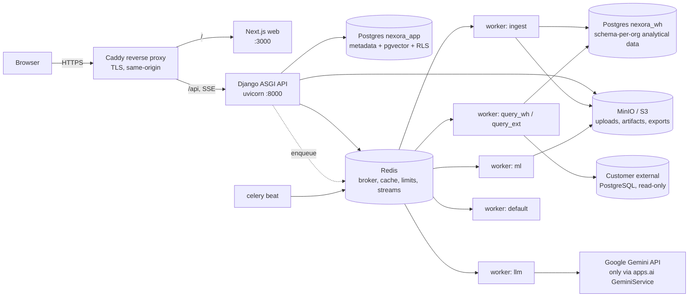

# System Architecture

> Status: **Design.** Last updated 2026-11-17. Related: `MULTI_TENANCY_DESIGN.md`, `AI_ARCHITECTURE.md`, `SECURITY_ARCHITECTURE.md`, `DEPLOYMENT_ARCHITECTURE.md`.

## 1. Architectural style: modular monolith

Nexora is **one Django codebase** with strict module (Django app) boundaries, deployed as several **processes** from the same image. Microservices are deliberately avoided at first:
- **One developer:** a single repository, deployment, migration history and test suite.
- **Transactions:** cross-module workflows like "ingest dataset → register semantic table → write audit" stay ACID inside one database transaction.
- **Boundaries are still enforced:** import-linter layering contracts, per-app ownership (`AGENT_DEVELOPMENT_STRATEGY.md`), and cross-app calls only through each app's `services.py`, which implements the Protocols in `contracts/python/`.
- **Extraction path:** a module with a clean `services.py` boundary can later become a service (most likely candidates: `sqlguard` executor, `documents` OCR worker, `ml` training) without touching its callers' code.

## 2. Runtime topology



### 2.1 Processes
| Process | Command (container) | Purpose | Scaling notes |
|---|---|---|---|
| `web` | `next start` | Next.js UI (App Router) | Stateless |
| `api` | `uvicorn nexora.asgi:application` | DRF REST + async SSE endpoints | Stateless; holds no DB transaction while streaming |
| `worker-ingest` | `celery -A nexora worker -Q ingest` | File parsing, profiling, pipeline steps, warehouse loads | CPU and memory heavy; concurrency 2 |
| `worker-query` | `celery … -Q query_wh,query_ext` | Guarded SQL execution | `query_ext` gets restricted network egress in production |
| `worker-llm` | `celery … -Q llm` | All Gemini calls (global rate limiter) | Concurrency 2–4; limited by quota, not CPU |
| `worker-ml` | `celery … -Q ml` | Embeddings, OCR, training, batch prediction | Concurrency 1 on the dev box (RAM) |
| `worker-default` | `celery … -Q default` | Email, retention, exports, audit compaction | Small |
| `beat` | `celery -A nexora beat` (django-celery-beat) | One dispatcher task that enqueues per-org schedules | Single instance |
| `postgres` | `pgvector/pgvector:pg17` | Two databases: `nexora_app`, `nexora_wh` | Same cluster for the MVP |
| `redis` | `redis:7` | Celery broker and result backend, cache, token buckets, Redis Streams for job events | |
| `minio` | `minio/minio` | S3-compatible object storage | Replaced by any S3 store in production |
| `caddy` | `caddy:2` | TLS, same-origin routing, SSE-friendly (no buffering) | |
| `mailpit` (dev only) | `axllent/mailpit` | Captures outgoing email | Replaced by a transactional provider in production |

## 3. Module (Django app) map

| App | Responsibility | Owner agent | Phase |
|---|---|---|---|
| `core` | Tenancy primitives (`TENANT_GUC`, `tenant_context`, `TenantModel`, `TenantTask`, `EnableTenantRLS`), audit, crypto (envelope encryption), permission framework, jobs and SSE (Redis Streams) | Backend | 1–2 |
| `accounts` | Users, authentication, sessions, MFA, API keys | Backend | 2 |
| `orgs` | Organizations, memberships, invitations, roles, AI data-policy consent | Backend | 2 |
| `governance` | Dataset ACLs, column and row policies, user attributes, retention, access history, usage metering, PII tags | Backend | 5 |
| `ai` | `GeminiService`, prompt registry, quota and circuit breaker, `AIDataPolicy` gate, local embedding service | AI/ML | 1–4 |
| `connectors` | Data sources, credential vault, connector plugins (CSV, Excel, JSON, PostgreSQL; later MySQL, REST) | Data Eng | 3 |
| `datasets` | Datasets, versions, columns, uploads, profiling | Data Eng | 3 |
| `pipelines` | Pipeline DAGs, steps, schedules, runs, retries | Data Eng | 3 |
| `quality` | Quality rules, results, reports | Data Eng | 3 |
| `lineage` | Lineage graph | Data Eng | 3 |
| `warehouse` | `nexora_wh` provisioning (per-org schema and roles), loader | Data Eng | 3 |
| `semantic` | Semantic layer: tables, columns, metrics, schema cards | Data Eng | 4 |
| `sqlguard` | SQL validation, secure-source rewrite, plan check, read-only executor | Data Eng | 4 |
| `nl2sql` | Question router, exact and semantic caches, deterministic builder, prompt assembly | AI/ML | 4 |
| `bi` | Conversations, messages, query audit, saved queries, dashboards, exports, SSE chat endpoint (orchestration) | Backend | 4 |
| `documents` | Document ingestion, OCR, chunking, RAG | AI/ML | 8 |
| `ml` | ML workspace, training, registry, prediction API, monitoring | AI/ML | 9 |
| `customers` | Customer 360 (identity resolution, profiles, events, segments) | Data Eng | 6 |
| `products` | Product 360 (normalization, matching, corrections) | Data Eng | 7 |
| `automation` | Workflows, triggers, approvals, agent configs | Backend | 10 |
| `platform_admin` | Super-admin APIs (org overview, health, jobs, quota) | Backend | 11 |

### 3.1 Layering (enforced by import-linter)

```
core
  ↑
accounts, orgs, ai            (ai imports only core/orgs)
  ↑
governance
  ↑
connectors, datasets, warehouse, quality, lineage, pipelines, semantic, sqlguard
  ↑
nl2sql, documents, ml
  ↑
bi, customers, products, automation, platform_admin
```

- A module may import only from layers below it, and only from `apps.<x>.services` or `apps.<x>.models` (models only for FKs).
- Upward calls (for example `sqlguard` publishing job events) go through `core.jobs`, or through callbacks registered at app ready time.

## 4. Technology stack and rationale

| Concern | Choice | Rationale | Rejected alternatives |
|---|---|---|---|
| Language (backend) | Python 3.12 | Data, ML and AI ecosystem | — |
| Web framework | **Django 5.x + Django REST Framework** | Mature ORM and migrations, auth, admin, permissions, large ecosystem | FastAPI (more glue for auth, migrations and admin; good, but more to build solo) |
| OpenAPI | drf-spectacular | Generates the schema to diff against `contracts/openapi.yaml` | — |
| ASGI server | uvicorn | Async views for SSE | gunicorn sync (cannot stream efficiently) |
| Background jobs | Celery 5 + Redis + django-celery-beat | Mature retries, routing, scheduling | RQ (weaker routing and scheduling), Dramatiq (fine, but a smaller ecosystem) |
| Metadata DB | PostgreSQL 17 + pgvector | RLS, JSONB, partitioning, vectors in one engine | Separate vector DB (more ops work) |
| Analytical store | PostgreSQL 17 (`nexora_wh`, schema-per-org) | Privilege-level isolation for AI-generated SQL; one engine to operate | DuckDB per tenant (attractive, but weaker concurrent multi-user access and no role-based isolation); ClickHouse (more ops) |
| Dataframes | Polars (primary), pandas (compatibility), pyarrow | Polars streaming is fast and memory-efficient | — |
| Excel | `python-calamine` (read), openpyxl (read-only mode or export) | Fast, safe | xlrd (legacy) |
| SQL parsing | sqlglot | AST validation and rewriting for the guard | Regex (unsafe) |
| External DB access | psycopg 3, SQLAlchemy 2 (introspection) | — | — |
| AI | `google-genai` SDK, Gemini only | Hard requirement. `google-generativeai` is deprecated. | Any other LLM provider (prohibited) |
| Embeddings | sentence-transformers, `intfloat/multilingual-e5-base` (default), `BAAI/bge-m3` (evaluated) | Local, multilingual (en, hi, gu), CPU-friendly | Gemini embeddings (optional future configuration only) |
| ML | scikit-learn, XGBoost, SHAP, statsmodels | Standard, explainable | PyTorch only if justified later |
| Entity resolution | rapidfuzz, Splink (DuckDB backend) | Open-source probabilistic matching | — |
| Documents | pdfplumber, pypdf, python-docx, openpyxl, Tesseract (eng, hin, guj) | Permissive licences | PyMuPDF (AGPL) |
| PII detection | Presidio + column-name heuristics + regex | Open-source | — |
| Frontend | Next.js (App Router), TypeScript, Tailwind, Radix primitives (shadcn-style, re-themed), TanStack Query and Table, Recharts, @xyflow/react, Framer Motion, next-themes, zod, react-hook-form | Prescribed candidates; strong component model | Generic admin templates (explicitly avoided) |
| API client | openapi-typescript + typed fetch wrapper (generated from `contracts/openapi.yaml`) | Contract-first | Hand-written clients |
| Reverse proxy | Caddy | Automatic TLS, simple SSE config | nginx (fine; more configuration) |
| Object storage | MinIO (dev and self-host), any S3 (production) | S3 API everywhere | Local disk (does not scale) |
| Observability | structlog JSON logs, Prometheus + Grafana, Sentry (self-hosted or free tier), OpenTelemetry later | — | — |

## 5. Request lifecycles

### 5.1 Standard authenticated REST request
1. Caddy routes `/api/*` to uvicorn. The session cookie (httpOnly, `SameSite=Lax`, `Secure`) authenticates the request, and CSRF is verified for unsafe methods.
2. DRF view `initial()` (base class `TenantAPIView`):
   - resolves `{org_slug}` from the URL and verifies an active membership;
   - sets `core.tenancy.context.current_org` (a ContextVar);
   - opens `tenant_context(org_id)`, which is `transaction.atomic()` + `SELECT set_config('app.org_id', <uuid>, true)`.
3. The permission classes check the role's permissions (and the dataset ACL where relevant).
4. ORM queries use `TenantManager`, which filters by `org_id` and fails closed if no org is set. Postgres RLS applies independently.
5. Mutations call `core.audit.record(...)` inside the same transaction.
6. The middleware's `finally` block clears the ContextVar.

### 5.2 Long-running job (ingest, pipeline run, NL question)
1. `POST` creates a job row and enqueues a Celery task on the right queue with `org_id`/`actor_id` kwargs. The API returns `202 {job_id}`.
2. The worker's `TenantTask` verifies the org, runs inside `tenant_context`, and publishes events with `core.jobs.publish(job_id, event)`, which does `XADD org:{org}:job:{id}`.
3. The client opens `GET /api/v1/orgs/{org}/jobs/{id}/events` (SSE). The async view checks ownership once in a short transaction, then `XREAD`s the stream. Resuming is supported via `Last-Event-ID`, with a heartbeat every 15 s.

### 5.3 Conversational BI question (summary; details in `AI_ARCHITECTURE.md` §6)

```mermaid
sequenceDiagram
  participant U as User
  participant API as bi (API)
  participant N as nl2sql
  participant AI as ai.GeminiService
  participant G as sqlguard
  participant WH as nexora_wh (wh_q_org)
  U->>API: POST message (question)
  API->>API: authz + effective_policy + AIDataPolicy check
  API->>N: propose(question, ctx)
  N->>N: exact cache → semantic cache → deterministic builder
  alt no cache/builder hit and policy allows
    N->>AI: generate_structured(schema card, question)
    AI-->>N: {sql, explanation, chart_hint}
  end
  N-->>API: SqlProposal
  API->>G: validate(sql, QueryPolicy)
  G-->>API: GuardResult (rewritten SQL or reject)
  API->>G: execute(GuardResult, target)
  G->>WH: BEGIN READ ONLY; EXPLAIN check; SELECT…
  WH-->>G: rows (capped)
  G-->>API: ResultSet
  API->>API: insights (local), audit, cache store
  API-->>U: SSE: status, sql, result, token(s), done
```

## 6. Cross-cutting concerns

| Concern | Approach |
|---|---|
| Configuration | `django-environ`; settings split into `base/dev/test/prod`; every variable documented in `.env.example` |
| Errors | RFC 7807 problem+json; a stable `code` per error; `request_id` in every response and log line |
| Logging | structlog JSON with `request_id`, `org_id`, `user_id`, `job_id`. **Secrets and prompt bodies are never logged by default.** |
| Idempotency | `Idempotency-Key` header on POSTs that start jobs; keys stored in Redis for 24 h |
| Time | All timestamps `timestamptz` in UTC; the UI renders in the user's timezone; Gemini quota reset shown at midnight Pacific, converted |
| IDs | UUIDv7 primary keys (time-ordered, index-friendly); short org IDs (base32) for schema and role names |
| Files | Uploaded to MinIO via the API (streamed) under `orgs/{org_id}/…`; size limits enforced; checksums stored |
| Feature flags | `settings.FEATURES` plus per-org overrides in `organization.settings` JSON |

## 7. Development environment (Windows)

- All server-side processes run in **Docker Compose**. Celery has no official Windows support, and pgvector has no simple Windows build. Use the `pgvector/pgvector:pg17` image rather than the locally installed PostgreSQL 17, which can stay installed but is not used.
- **The project path contains spaces** (`D:\nexora enterprice ai`). Containers mount the repository at `/app`; scripts quote paths.
- The frontend can run natively (`npm run dev`) or in Compose. Caddy provides same-origin `/api` routing in both cases, so cookies and CSRF behave the same as in production.
- Agents running tests in parallel share one infra stack, isolated by test database name, Redis DB index and MinIO prefix (`AGENT_DEVELOPMENT_STRATEGY.md` §4).

## 8. Repository layout

```
nexora/
  docs/                      # these design documents
  contracts/                 # openapi.yaml, events/*.schema.json, python/ Protocol stubs
  coordination/              # OWNERSHIP.md, handoffs/<wave>/<agent>.md
  backend/
    nexora/                  # settings, asgi, celery, root urls
    apps/                    # one directory per Django app (§3)
    testing/                 # shared fakes and fixtures (QA-owned)
    tests/                   # cross-cutting suites: isolation/, security/, ai_eval/, integration/
  frontend/                  # Next.js app
  e2e/  perf/                # Playwright, k6
  testdata/                  # synthetic dataset generators
  infra/                     # compose, Caddy, Postgres init SQL, Grafana
  scripts/                   # check_ownership.py, check_tenant_guc.sh, etc.
  .github/workflows/
```

## 9. Architecture decision log (summary)

| ID | Decision | Status |
|---|---|---|
| ADR-001 | Modular monolith (Django), processes split by workload | Accepted |
| ADR-002 | Shared DB + `org_id` + RLS for metadata; schema-per-org `nexora_wh` for analytical data | Accepted |
| ADR-003 | Gemini is the only external LLM; model IDs come from configuration; no fallback provider | Accepted |
| ADR-004 | Default `AIDataPolicy = synthetic_only`; `schema_only` requires org-admin consent | Accepted |
| ADR-005 | Local multilingual embeddings (multilingual-e5-base) by default | Accepted |
| ADR-006 | Session-cookie auth, same-origin via Caddy; no JWT in browser storage | Accepted |
| ADR-007 | SSE over Redis Streams for job and chat events | Accepted |
| ADR-008 | sqlglot-based guard + secure-source rewrite + DB role isolation for NL→SQL | Accepted |
| ADR-009 | Contract-first, ownership-based parallel agent development | Accepted |
| ADR-010 | Avoid AGPL dependencies (e.g. PyMuPDF) | Accepted |
